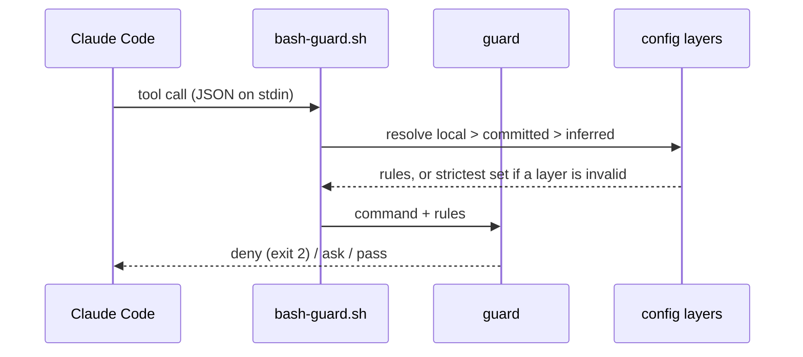

# How dw-sdlc works

The repository holds the software delivery process Dominik works by and the Claude Code tooling that
carries it: a plugin marketplace and the code behind it. Its one plugin, `sdlc`, carries a set of
deterministic hooks that stop an agent session from doing the damage a human would not: rewriting
history, reading a secret, installing through the wrong package manager, committing sloppily. Beside
them it carries the Sync of a repository's References and the skills that set a repository up,
check a machine and ship a pull request. This page is the long version of the README: how a guard
judges a call, where its rules come from, how the Gate runs, why the design is shaped this way, how
the plugin is adopted and released, and how a pull request lands. Every guard in full is in the
[plugin README](../plugins/sdlc/README.md).

## How a guard judges a call

Every guard is a shell hook. Claude Code hands it the tool call as JSON on stdin before the call
runs, and the guard answers with one of three verdicts: deny (exit 2, the call never runs), ask (a
permission prompt), or pass (silent). Bash commands go through one dispatcher that parses the
payload once and spawns only the guards the command could trip.



## Where the rules come from

The rules come from the repository, not from the plugin. `.ai/agentic.config.json` declares the
package manager, protected branches, env-file policy and commit convention, and `pr.merge`, who
merges a pull request the Ship script finds ready: the script under `auto`, the dev under `ask`, the
default. A machine may add `.ai/agentic.config.local.json` on top, which can tighten `guardrails` and
`pr.merge` and never loosen them. Any key neither file sets is inferred: pnpm from the lockfile, and
the `conventional` commit convention. A repository whose subjects start with a ticket key sets
`commit.convention: ticket-key` in either file. A linked worktree reads a layer it lacks from its main
checkout, so a repository that keeps `.ai/` out of git needs no copy per worktree. An invalid layer is
dropped whole and the guards run on the strictest set, `pr.merge: ask` with it, until it is fixed;
the session start hook names each problem.

The guards judge the agent's tool calls only. A commit typed in a terminal meets the subject rule
through git's `commit-msg` hook: `hooks/commit-msg.sh` resolves the same config and refuses a subject
off the pattern. This repository runs it from `.vite-hooks/commit-msg`, a Vite+ git hook. The trailer
stays the agent's rule, since a commit a person writes has no co-author to name.

The plugin guards Node repositories, and App Store Connect from every repository: `asc` reaches the
whole store account from any directory. It carries no other stack-specific guard;
`packageManagers.ruby` is accepted by the schema and read by nothing.

## How the Gate runs

`pnpm check` is the Gate, the one command a change must pass, the same in a terminal and in CI. Its
script is `dw-sdlc gate`, the bin of the `dw-sdlc` package, which reads the `gate` key of the
resolved config. The Steps under `gate.steps` run in order from the repository root through `sh -c`,
each one's output passed through, and the first that fails ends the Gate. Then every Check under
`gate.checks` runs, and a failed Check does not stop the next: first a repository's own scripts,
which join through `gate.checks.run` as a `name` and a `command`, then the Checks the package ships.
The schema refuses a Check name the package does not ship. `gate.command` is the command an agent or
a person runs, inferred as `pnpm check` from the `check` script of `package.json` when no layer sets
it.

Every failure is one line naming the file where there is one, the rule and the remedy:

```text
.ai/agentic.config.json: config: gate.checks: unknown key "nope" — fix the file; the Gate runs once every layer is valid
step: "pnpm exec vp check" exited 1 — fix what it printed above
```

Under GitHub Actions each line is also a workflow annotation on its file. `--json` prints the same as
one document on stdout, with the status, the resolved command, each Step and Check with its exit
code, and the failures; the commands' own output then goes to stderr. A Check the package ships runs
inside the bin, so its `command` is null. The exit code is 0 when everything passes, 1 when a Step or
a Check fails, and 2 when the Gate cannot run: an invalid config layer, a Step or Check whose command
the shell cannot find or execute, or a Check missing an input it reads, such as a Ratchet's
baseline. Why a Check is a named unit turned on in the config is
[ADR 0009](adr/0009-checks-are-named-units-turned-on-in-the-config.md).

### The Checks the package ships

A Check the package ships is `true` under `gate.checks` for its defaults, an options object over
them, or `false`; the schema's descriptions name each option and its default. Each is one module
under `packages/dw-sdlc/src/checks/`, one row of the list the Gate runs them in, and one key of the
schema.

- `primitives` holds the Primitives catalogue, `.ai/primitives.json`, to the tree: unique ids, a
  group that `groups` lists, a summary of one line within 120 characters, every `code` and `docs`
  path on disk with its heading anchor resolving, and every file under the roots named by the `code`
  of a Primitive, the file itself or a directory above it. The roots are `packages`, `plugins`,
  `scripts` and `src` by default; a test file needs no Primitive.
- `agents-map` holds `AGENTS.md` to 150 lines and 10240 bytes, to naming the resolved
  `gate.command`, to a Task Router row that points at the catalogue where there is one, and to every
  path the Task Router points at existing. It holds `CLAUDE.md` at the root to a symbolic link to
  the map by its path from the root, so Claude Code reads the map the Gate judges; a map named
  `CLAUDE.md` needs no link. Where the repository has them, it keeps the skills directory,
  `skills-lock.json` and the `.claude/skills` links in step.
- `markdown-budget` holds each file a glob matches to that glob's line and byte budget, by default
  the agent docs, `docs/agents/*.md`, to 100 lines and 6144 bytes. A glob that matches no file fails.
- `markdown-refs` fails a relative link or image whose path is not a file or directory of the
  repository, or whose heading anchor names no heading of the markdown file it points at. A link
  with a scheme, such as `https:`, and a link inside code are not judged.
- `temporal-language` fails a changelog phrase in a durable document: the list kody's docs check
  holds, as [the research notes](research/gate/kody.md#two-checks-read-whole) record it, such as
  `we now`, `is now the` or `no longer supports`, matched across a line break and never inside code.
  Decision records, research notes and changelogs record a point in time, so `docs/adr/`,
  `docs/decisions/`, `docs/research/` and every `CHANGELOG.md` are exempt by default.
- `decision-records` holds the records under `docs/adr`, or the template's `docs/decisions`, to
  files named `<number>-<slug>.md`, numbered from 1 with no gap and no number taken twice, each with
  a level-1 heading for its title and a frontmatter `status` whose first word is `proposed`,
  `accepted`, `active`, `deprecated` or `superseded`.
- `file-size-ratchet` is a Ratchet. It holds each file to the line limit of the first group whose
  glob matches it: `tests` 2000, `agent-docs` 120 (`AGENTS.md`, `CLAUDE.md`, `GLOSSARY.md` and
  `docs/agents/`), `source` 500. A file over its limit passes only when the committed baseline,
  `.ai/file-size-ratchet.baseline.json`, lists it, and then only up to the count recorded there.
  A baseline that lists a file twice, at a count within its group's limit or in no group fails the
  Check.
- `comment-budget` holds each comment block in the JavaScript, TypeScript and shell (`.sh`) under
  `packages`, `plugins`, `scripts` and `src` to 3 lines of prose. A block is one `/* … */` comment or
  a run of `//` or `#` lines, each alone on its line; a comment after code is none. In shell, a `#`
  opens a comment only where it starts a word of code: never inside a quote, a `${…}`, an arithmetic
  `((…))` or a heredoc body, and the shebang on line 1 is none.

The Checks that read many files judge the ones git tracks or would track, never one it ignores, so a
link to an ignored file, or to another case of a file's name, fails on a Mac as it fails in CI. A
glob's `*` and `**` skip a name that starts with a dot, as a shell does: `**/*.md` leaves the
vendored skills under `.agents/` out.

`dw-sdlc gate --update-baseline` runs the Gate, then rewrites the baseline of each Ratchet, only when
every Step and every other Check passed. It only tightens: a file within its limit leaves the list, a
count that shrank is lowered, and no file joins. Where there is no baseline it records one, every
file over its limit at its count, unless HEAD holds one the tree lost: that one is restored with git,
never recorded again. A refused refresh leaves the file byte for byte as it was.

`dw-sdlc check <name>` runs one Check of the Gate alone, so a person iterates on one Check and a
skill reads one result. The name is a script under `gate.checks.run` or a Check the package ships; a
name both carry runs both, as the Gate does. No Step runs and no other Check. A shipped Check runs
on the setting `gate.checks` gives it, and on its defaults where the config sets it `false` or
leaves it out, so a Check can be tried before it is turned on. Its lines, its exit codes and its
`--json` document are the Gate's, the document with no Step. It takes no `--update-baseline`: a
refresh needs every other Check to pass, and only the Gate runs them.

`dw-sdlc primitives --paths <files>` answers from the same catalogue: for each path, the Primitives
whose `code` names it nearest, with their summaries and the documents to read, or that none does.

## Why this way

Each choice below is a one-paragraph decision record in `adr/`.

- **One plugin, not hooks copied into every repository.** Copies drift; a plugin gives one shared
  library and one line to enable. [ADR 0001](adr/0001-guards-ship-from-this-marketplace.md)
- **The guards, the Sync and the skills are that one plugin.** One `enabledPlugins` line and one
  version cover a machine, and a machine takes every part or none.
  [ADR 0010](adr/0010-one-sdlc-plugin-carries-guards-sync-and-gate.md)
- **Policy is a validated config file, not prose.** A hook parsing a markdown rule is fragile; a JSON
  file against a schema is checked before it is trusted.
  [ADR 0002](adr/0002-agent-rules-are-a-validated-config-file.md)
- **An invalid layer runs the strictest set.** A typo must never quietly loosen a guard.
  [ADR 0003](adr/0003-invalid-config-layer-runs-strictest.md)
- **A lease push passes, a bare force push is refused.** Feature branches get rebased; protected
  branches take pull requests. [ADR 0004](adr/0004-lease-push-passes-bare-force-refused.md)
- **Env access is a list in the config, git as the fallback.** Some repositories track `.env` on
  purpose; a guard refusing every `.env*` by name blocks real work.
  [ADR 0005](adr/0005-env-access-is-a-list-in-the-config.md)

The repository's own supply chain follows the same idea: `pnpm-workspace.yaml` refuses any dependency
version younger than 7 days, exotic transitive sources and unlisted install scripts. The research
behind that and the plugin is in
[`research/agentic-guardrails/`](research/agentic-guardrails/agentic-guardrails.md).

## Adopting it in your repository

Run `/sdlc-setup` in the repository. It sets the repository and the machine up, a dry run first,
and writes only what would change. In a repository with a `package.json` it adopts the Gate. It asks
before it adds `dw-sdlc` as a devDependency, naming the version it pins, the one the plugin runs,
and stops on a no. On a yes it pins the package and runs the install. The committed
`.ai/agentic.config.json` gains a `gate` key when it has none, created when absent; a `gate` key it
has stays. The key turns on `markdown-refs`, `temporal-language` and `comment-budget`, which judge
the tree as it is, and `agents-map`, which reads the map the user writes. Every other Check is
`false`, since each reads an input the repository adds first: a catalogue, a records directory, the
docs a glob matches, a Ratchet's baseline. The setup never writes `AGENTS.md`: the first
`dw-sdlc gate` names what the map lacks through `agents-map`. The Ratchet joins once the Gate is
green: `file-size-ratchet` set to `true`, then `dw-sdlc gate --update-baseline` records the
baseline to commit.

For the machine, the setup writes the local config layer from what it infers, plus the commit
convention when asked for one, excludes it from git, and adds a permission backstop to
`.claude/settings.local.json` plus the lease-push exception to `~/.claude/settings.json`. Where those
settings still enable `guardrails@dw-sdlc` or `references@dw-sdlc`, it prints the `enabledPlugins`
edit and leaves it to the user. It ends with the doctor, one PASS / WARN / FAIL line per machine
check, and after a run that wrote the `gate` key, with one Gate run. The doctor needs only Node 24
and runs from the installed plugin: `/sdlc-doctor` in a session, or
`node <plugin root>/dw-sdlc/src/cli.ts doctor` from the repository in a terminal.

The rules a repository wants beyond the Gate go in the same `.ai/agentic.config.json`; validate it
with `node <plugin root>/dw-sdlc/src/cli.ts config <file>`, where the plugin root is the
`installPath` that `claude plugin list --json` names. This repository's own file is the smallest
useful example:

```json
{
  "$schema": "https://raw.githubusercontent.com/dominikwozniak/dw-sdlc/main/plugins/guardrails/config/agentic.config.schema.json",
  "version": 1,
  "packageManagers": { "node": "pnpm" },
  "guardrails": {
    "forcePush": "lease",
    "envFiles": { "policy": "git" },
    "protectedBranches": ["main"]
  },
  "commit": {
    "convention": "conventional",
    "trailer": "Co-Authored-By"
  },
  "gate": {
    "steps": ["pnpm exec vp check", "pnpm references:setup --check", "pnpm test"]
  }
}
```

A repository with nothing declared still gets the inferred defaults, so the file is optional. Each
key and its inferred value is described in the
[schema](../packages/dw-sdlc/config/agentic.config.schema.json). The `$schema` URL is an annotation
for editors; the guards always validate against the schema the plugin ships.

## From GitHub or from a clone

Added from GitHub with `--sparse .claude-plugin plugins packages`, the plugin is a snapshot of `main`
that `claude plugin update` refreshes, and the clone holds only the catalogue, the plugin and the
`dw-sdlc` package. The plugin reaches the package through its `dw-sdlc` link, which
`claude plugin install` copies as a real directory, so a hook and a skill run the package's
`dw-sdlc` bin. A clone without `packages` installs the plugin without it: the guards then drop
every config layer and run strictest, and no command of the package starts. Added from a clone with
`claude plugin marketplace add ./`, it runs live from that checkout, a broken edit included.
The daily install is the GitHub one; a guard is developed through `pnpm test`, which runs every hook on
a real payload.

## How a change lands

`main` is protected in `.ai/agentic.config.json`, so a change reaches it through a pull request, and
`quality-gate.yaml` runs `pnpm check` on it first. For a small fix the agent commits on `main` and the
push comes from Dominik's own terminal: the guards judge only the agent's tool calls. GitHub branch
protection is not available on this private repository, so the guard is the only check.

## How a pull request lands

The Ship script, `dw-sdlc pr ship [<n>]`, drives one pull request to merged. A call reads the pull
request's state through `gh` in one GraphQL query and decides the one Action it needs next. When that Action
is the script's own, the call performs it, reads again and decides again; it answers the first
Action that is not, as one line or, with `--json`, one document. The exit code says whose turn it
is: 0 done, 10 the agent's, 20 wait, 30 the dev's, 2 it cannot run. The script holds no state
between calls and never sleeps: a `wait` carries `recheckAfter`, the seconds until the next call.

The script owns three Actions, one `gh` command each. It updates a branch behind its base by
merging the base in, marks a draft ready once CI is green, no thread is open and the head is
reviewed, and squash merges with `--match-head-commit`, so a push during the decision never merges
blind. Each runs at most once per call; one that comes round again, and every one under
`--dry-run`, parks with its command for the dev.

The agent owns four: `fix-conflicts`, `fix-ci`, `address-review` and `review`. Under `details`,
`fix-ci` lists each failing check with its link and, for a GitHub Actions job, the command that
prints its log; `address-review` lists each open thread someone else commented on last, and with
none answers a review that requests changes. Every later Action that holds the pull request back
rides in `blockers`, so one push can fix several. The dev owns the rest: a closed pull request, a
head no check reported on within 120 s of its commit date, CI pending past its 40-minute budget, a
thread whose last comment is the viewer's and so awaits the reviewer, a required approval, and the
merge when it is not the script's.

Who merges follows `pr.merge`: the script under `auto`, the dev under `ask`, and the script for one
call under `--merge`. A pull request another author opened parks for the dev under either. A clean
review is a commit status: `dw-sdlc pr reviewed <n> --head <sha>` posts `dw-sdlc/review` in state
`success` on the head the review read and refuses once a push moved it, so a new head needs a fresh
review. Contexts under `dw-sdlc/` never count as CI. The script never deletes a branch: a
merged pull request answers `done` with the deletion command for the dev.

The `sdlc-pr-ship` skill is the agent's side: it calls the script, does the agent's Action, calls
again, and stops at a wait, a park or done, as the
[plugin README](../plugins/sdlc/README.md#shipping-a-pull-request) describes.

## Releasing the plugin

`plugins/sdlc/.claude-plugin/plugin.json` and its entry in `.claude-plugin/marketplace.json` carry
one version, and `claude plugin update` refreshes an installed copy by that version only. A change
to any part of the plugin ships when both files are bumped in one `chore: release sdlc x.y.z` commit
that lands on `main`. Installs from a clone see the change in the next session without a bump.

The plugin's version is its own, apart from the package's: a release of one never bumps the other.
Where the two meet, the doctor's `package` line names a drift between the `dw-sdlc` the plugin links
and the one a repository pins.

## Releasing the package

The `dw-sdlc` package goes to npm as JavaScript. Its source is TypeScript, and Node refuses to strip
types from a file under `node_modules`, so `pnpm pack` runs the package's `prepack`: `tsc` emits
`dist/` from `packages/dw-sdlc/tsconfig.build.json`. The manifest's `bin` and `exports` name the
source, so this repository's workspace link runs it as written; their twins under `publishConfig`
name `dist/`, and pnpm writes those into the packed manifest. `files` ships `dist/`, `config/` with the
schemas, and `templates/` with the Router the setup writes; pnpm adds the package's `README.md` and its MIT
`LICENSE` unasked, and the package has no runtime dependency. `test/pack.test.ts` packs it, installs
the tarball into a throwaway repository and runs `dw-sdlc gate` from that repository's `node_modules`.

A change to the package carries a changeset: `pnpm changeset` writes one under `.changeset/`, with
the bump and the line the changelog gets. On every push to `main`, `.github/workflows/release.yaml`
picks one of two modes:

- **version**, while a changeset is pending: it opens or updates the
  `chore(release): version packages` pull request, which bumps the version, writes `CHANGELOG.md`
  and deletes the changesets. GitHub opens it only when Settings → Actions → General allows GitHub
  Actions to create pull requests.
- **publish**, when npm lacks the version on `main`, which is what merging the version pull request
  makes true: one job runs `pnpm check` and packs the tarball with no secret in reach; the next
  publishes it, pushes the `dw-sdlc@x.y.z` tag and creates the GitHub release.

Merging the version pull request is the decision to release. The publish job signs in to npm by
trusted publishing alone: no secret and no `.npmrc` exist, and pnpm exchanges the job's OIDC token,
from its `id-token: write`, for a token scoped to the package. npm accepts the exchange because the
package's settings on npmjs.com hold a saved trusted publisher: `dominikwozniak/dw-sdlc`, the
workflow `release.yaml`, no environment, and `npm publish` allowed beside `npm stage publish`.
`pnpm publish`, which `changeset publish` runs, names `npm publish` in its request. The version goes
live on the registry about a minute later, with no approval, and its `_npmUser` names GitHub Actions
as the trusted publisher. A publish with no trusted publisher saved fails with `E404: 404 Not Found`
and no reason in the log: pnpm warns why it skipped OIDC, and changesets drops that warning. What the
releases showed is in the [research notes](research/gate/toolchain.md#npm-publishing).

npm attests provenance only for a build from a public repository, and this one is private, so the
workflow leaves pnpm's `provenance` setting unset and trusted publishing decides: a version published
from here carries no provenance, and once the repository is public npm attaches it. Trust evidence
then only grows from one version to the next. A consumer on `trustPolicy: no-downgrade` refuses a
version that carries less trust evidence than an earlier one, so a version after 0.1.0 never goes
out on an access token. A consumer takes a release through Dependabot after the seven days of
`minimumReleaseAge`; one that cannot wait names `dw-sdlc` in `minimumReleaseAgeExclude` under its own
rule for exclusions, as [ADR 0008](adr/0008-gate-runs-from-a-pinned-package-plugin-adapts.md)
records.
