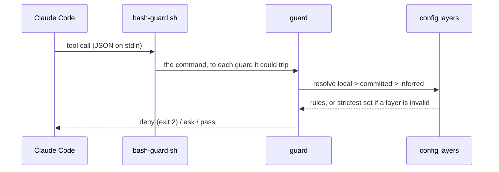

# How dw-sdlc works

This page explains how the parts of dw-sdlc fit together, for someone who uses the plugins. Each
section says what a part is for, shows it once, and links to where its flags and edge cases live.
Every guard in full is in the [plugin README](../plugins/sdlc/README.md); a word with a capital
letter, such as Landed or Finding, is defined in [`GLOSSARY.md`](../GLOSSARY.md). How this repository
is built and released is under [`contributing/`](contributing/development.md).

## The parts at a glance

| part                                             | runs when                                     | started by                                                  | detail                                                                   |
| ------------------------------------------------ | --------------------------------------------- | ----------------------------------------------------------- | ------------------------------------------------------------------------ |
| the guards                                       | on every Bash command, file tool and Grep     | Claude Code, as hooks                                       | [How a guard judges a call](#how-a-guard-judges-a-call)                  |
| the session hooks                                | when a session starts                         | Claude Code, as hooks                                       | [plugin README](../plugins/sdlc/README.md#session-start)                 |
| the `commit-msg` hook                            | on a commit typed in a terminal               | git, once a repository wires it                             | [plugin README](../plugins/sdlc/README.md#commit-hook)                   |
| the Gate, `pnpm check`                           | before a change lands, locally and in CI      | you, a Brief's Proof, CI                                    | [How the Gate runs](#how-the-gate-runs)                                  |
| `/sdlc-setup`, `/sdlc-doctor`                    | once per repository and machine, then at will | you                                                         | [Adopting it](#adopting-it-in-your-repository)                           |
| `/sdlc-pr-open`                                  | when a pull request is wanted                 | the agent, once you or a Brief want one                     | [plugin README](../plugins/sdlc/README.md#opening-a-pull-request)        |
| `/sdlc-pr-ship` and the Ship script              | from an open pull request to merged           | you, or a Brief                                             | [How the Ship script merges](#how-the-ship-script-merges-a-pull-request) |
| `/sdlc-recap`, `/sdlc-kickoff`, `/sdlc-delegate` | at a session's end, or to hand work on        | you, or a Brief; offered where `.ai/` is set up, then waits | [How a Lead runs Workers](#how-a-lead-runs-workers)                      |
| `/sdlc-sweep`                                    | once work has landed                          | you, or your "go" on a Recap follow-up                      | [How a Sweep removes](#how-a-sweep-removes-what-finished-work-leaves)    |

## Where dw-sdlc sits beside the engineering skills

dw-sdlc extends the engineering skills and replaces none
([ADR 0019](adr/0019-dw-sdlc-extends-the-engineering-skills.md)). The engineering skills are
[`mattpocock/skills`](https://github.com/mattpocock/skills); this repository pins them in
`skills-lock.json` under `.agents/skills/`. They plan, build and review the work, and each one stops
where it asks the dev. dw-sdlc holds them where they are loose: the guards judge every tool call a
skill makes, the Gate proves the change, and dw-sdlc carries the delivery from a Brief to the merge.

| stage                                | carried by                                    | invoked by                                              | whose      |
| ------------------------------------ | --------------------------------------------- | ------------------------------------------------------- | ---------- |
| chart a large effort                 | `wayfinder`                                   | the dev                                                 | mattpocock |
| settle a plan, gather facts          | `grilling`, `research`                        | the dev, or a skill                                     | mattpocock |
| write the spec and tickets           | `to-spec`, `to-tickets`, `triage`             | the dev                                                 | mattpocock |
| hand the work to a session           | `/sdlc-kickoff` writes a Brief, starts a Lead | the dev                                                 | dw-sdlc    |
| implement                            | `implement`, `tdd`, `code-review`             | the dev, or the start line of a Brief                   | mattpocock |
| implement a spec as one pull request | `implement-spec`                              | the dev                                                 | mattpocock |
| implement tickets in parallel        | `/sdlc-delegate` starts a Worker per ticket   | the dev                                                 | dw-sdlc    |
| keep an agent from harm              | the guards, the session hooks, `commit-msg`   | a hook, on every call or commit it judges               | dw-sdlc    |
| prove a change                       | the Gate, `pnpm check`                        | the dev, a Brief's Proof, CI                            | dw-sdlc    |
| open the pull request                | `/sdlc-pr-open`                               | the agent, once the dev or a Brief wants a pull request | dw-sdlc    |
| review, fix CI, merge                | `/sdlc-pr-ship` and the Ship script           | the dev, or a Brief                                     | dw-sdlc    |
| say where a session stands           | `/sdlc-recap`                                 | the dev, or a Brief                                     | dw-sdlc    |
| pass context to the next agent       | `handoff`                                     | the dev                                                 | mattpocock |
| remove what landed                   | `/sdlc-sweep`                                 | the dev                                                 | dw-sdlc    |

Without the engineering skills every part of dw-sdlc still runs but three: a Brief's start line names
`/implement`, a `full` Review runs `/code-review` unless `pr.reviewCommand` names another command, and
`/sdlc-delegate` reads the sub-issues a `/to-tickets` cut leaves.

### The ways to implement

| way                                   | where it runs                                   | needs herdr | pick it when                                      |
| ------------------------------------- | ----------------------------------------------- | ----------- | ------------------------------------------------- |
| `/implement #<n>` in this session     | the current branch; a pull request when you ask | no          | one issue, here and now                           |
| `/sdlc-kickoff`, `start`              | a new Lead, which starts one Worker for it      | yes         | one issue, in parallel; this session can close    |
| a Brief's start line, in any terminal | a new session in its own worktree               | no          | one issue, in parallel, outside herdr             |
| `/sdlc-delegate`                      | a Worker per ticket, each in its own worktree   | yes         | a spec cut into tickets: the usual way            |
| `implement-spec`                      | one pull request on an integration branch       | no          | rarely: a spec that must land as one pull request |

Claude Code creates a Worker's worktree from the `--worktree <name>` flag of its start line. The Sweep
removes it once the Worker's work has landed.

### Which session skill, and what it adds beside `triage` and `handoff`

| you want                                                     | skill            |
| ------------------------------------------------------------ | ---------------- |
| new work to run in a session of its own, cared for by a Lead | `/sdlc-kickoff`  |
| this session to start and watch Workers itself               | `/sdlc-delegate` |
| to know where this session stands, or to close it            | `/sdlc-recap`    |
| the same work carried on in a fresh session                  | `handoff`        |

- **A Brief beside `triage`'s agent brief.** The agent brief in the issue says what to build. A Brief
  says how the session runs: what it may write, what proves it done, how it ships and whom it reports
  to. It points at the issue and retells none of it.
- **A Recap beside `handoff`.** A Recap tells the dev where a session stands and whether it can close.
  A `handoff` document gives the next agent the context to carry on. A Brief carries none of the
  conversation: it points at a source the Worker reads itself, so work only the conversation holds
  goes with `handoff`.

## How a guard judges a call

A guard is a shell hook that answers a tool call with a verdict. Claude Code hands it the call as JSON
on stdin before the call runs. It answers deny (exit 2, the call never runs), ask (a permission
prompt), or pass (silence). One guard runs after the call instead: `large-file-guard.sh` flags a
written file over 256 KiB, as advice.

Bash commands go through one dispatcher, `bash-guard.sh`. It parses the payload once and spawns only
the guards the command could trip. A deny ends the chain. An ask waits for the other guards, so a
later deny still wins.



The guards catch the commands an agent writes in ordinary work, not a deliberate evasion. What gets
past them is listed in the plugin README's
[Known limits](../plugins/sdlc/README.md#known-limits).

## Where the rules come from

The rules live in the repository, not in the plugin. Three layers set them, the higher one winning:

| layer     | file                                             | written by                    |
| --------- | ------------------------------------------------ | ----------------------------- |
| local     | `.ai/agentic.config.local.json`, kept out of git | `/sdlc-setup`, on one machine |
| committed | `.ai/agentic.config.json`                        | the repository                |
| inferred  | none                                             | the guards, from the checkout |

- A key no file sets is inferred: pnpm from the lockfile. No commit convention is inferred: with none
  set, a commit subject goes unchecked.
- The local layer may tighten `guardrails`, `pr.merge` and `pr.review`. It never loosens them.
- `pr.reviewCommand` and `worker` have no strictness order, so any layer sets them.
- A linked worktree with no layer of its own reads the main checkout's.
- An invalid layer is dropped whole. Until it is fixed, the guards run the strictest set, with
  `pr.merge: ask` and `pr.review: full`, and the session start names each problem.

| key               | what it decides                                                          |
| ----------------- | ------------------------------------------------------------------------ |
| `guardrails.*`    | protected branches, force push, commits on them, env files, piped output |
| `commit.*`        | the subject convention, or a pattern, and a required trailer             |
| `packageManagers` | the Node package manager the guards allow                                |
| `baseBranch`      | the branch a Landed branch's work must be on                             |
| `gate.*`          | the Steps and Checks of the Gate                                         |
| `pr.*`            | who merges, how deep a Review reads, which command reviews               |
| `worker.*`        | how a Worker's Claude Code session starts                                |
| `worktree.setup`  | the commands a new worktree's session is told to run                     |

Each key, its default and its strictness order are in the
[schema](../packages/dw-sdlc/config/agentic.config.schema.json). `/sdlc-setup` writes
`worker.command` into the local layer when `cswap`, an account switcher, is on PATH.

The guards judge the agent's tool calls only. A commit typed in a terminal meets the subject rule
through git's `commit-msg` hook, which resolves the same config. The trailer stays the agent's rule,
since a commit a person writes has no co-author to name.

The plugin guards Node repositories, and App Store Connect from every repository, since `asc` reaches
the whole store account from any directory. It carries no other stack-specific guard.

## Adopting it in your repository

`/sdlc-setup` sets a repository and a machine up. It shows a dry run first and writes only what would
change.

1. Run `/sdlc-setup` in the repository. It writes this machine's layer, keeps it out of git, and
   adds the permission backstops.
2. In a repository with a `package.json`, say yes to the `dw-sdlc` devDependency it proposes. It
   pins the version the plugin runs and adds a `gate` key to `.ai/agentic.config.json`, with the
   Checks that need no input of yours turned on.
3. Run `pnpm check`. The first run names what the Agent map, `AGENTS.md`, still lacks.
4. Read the doctor's lines at the end. `/sdlc-doctor` runs it again.

What the setup writes, file by file, and which Checks it turns on are in the plugin README's
[Setup](../plugins/sdlc/README.md#setup). The rules a repository wants beyond the Gate go in the same
`.ai/agentic.config.json`. A small useful file:

```json
{
  "$schema": "https://raw.githubusercontent.com/dominikwozniak/dw-sdlc/main/packages/dw-sdlc/config/agentic.config.schema.json",
  "version": 1,
  "packageManagers": { "node": "pnpm" },
  "guardrails": {
    "forcePush": "lease",
    "envFiles": { "policy": "git" },
    "protectedBranches": ["main"]
  },
  "commit": {
    "convention": "conventional",
    "trailer": "Co-Authored-By"
  },
  "gate": {
    "steps": ["pnpm exec vp check", "pnpm references:setup --check", "pnpm test"]
  }
}
```

| you want                              | committed key                                   | one machine only                         |
| ------------------------------------- | ----------------------------------------------- | ---------------------------------------- |
| subjects that start with a ticket key | `"commit": { "convention": "ticket-key" }`      | `/sdlc-setup ticket-key`                 |
| every change on a branch              | `"guardrails": { "commitOnProtected": "deny" }` | `/sdlc-setup --commit-on-protected deny` |
| a prompt before each lease push       | `"guardrails": { "forcePush": "ask" }`          | `/sdlc-setup --force-push ask`           |

The file is optional: a repository with nothing declared still gets the inferred defaults. Validate it
with `node <plugin root>/dw-sdlc/src/cli.ts config <file>`; the plugin root is the `installPath` that
`claude plugin list --json` names. The `$schema` URL serves editors only. The guards always validate
against the schema the plugin ships.

## How the Gate runs

The Gate is the one command a change must pass, `pnpm check`, in a terminal and in CI. Its script is
`dw-sdlc gate`, which reads the `gate` key of the resolved config.

- **Steps** run first, in order, each a shell command from `gate.steps`. The first that fails ends
  them. A Step may carry a Hint, one line naming what to try when it fails.
- **Checks** run next, all of them, a failure stopping none: first the repository's own scripts under
  `gate.checks.run`, then the Checks the package ships.
- **Drift.** Every file a Step creates, changes or deletes in the tree git tracks is one failure. So a
  stale generated file fails a local `pnpm check` as it fails a `git diff --exit-code` in CI.
  `gate.drift: "allow"` turns the watch off.

The Gate is quiet, so its whole report fits in what an agent's Bash tool shows. A passing Step prints
one line; a failing one prints its last 50 lines:

```text
gate: step pnpm exec vp check — pass (4 s)
gate: step pnpm test — failed, exit 1 (71 s); its last 50 lines:
  …
  ✖ failing tests:
  …
step: "pnpm test" exited 1 — fix what it printed above; run it alone for the full output
gate: failed — 1 failure
```

| command                          | what it does                                                               |
| -------------------------------- | -------------------------------------------------------------------------- |
| `dw-sdlc gate --verbose`         | streams every command's output live, as CI runs it                         |
| `dw-sdlc gate --json`            | one document: each Step and Check, its exit code, its tail, the failures   |
| `dw-sdlc gate --cache`           | skips the run when the tree matches the last green run in this checkout    |
| `dw-sdlc gate --update-baseline` | after a green run, tightens each Ratchet's baseline                        |
| `dw-sdlc check <name> [--write]` | runs one Check alone; `--write` first writes what `skill-sections` derives |

The Quality Gate workflow runs `--verbose`, so the log of a job that times out shows how far the
tests got. `--cache` hashes the working tree only: what a Step or a Check reads outside it, such as
`node_modules`, the environment or `HEAD`, and an uncommitted edit inside a submodule, never changes
the hash, so a cached green can hide a failure they would cause. The stamp holds the hash taken before
the run, so a Gate that changes the tree runs again next time.

Exit 0 is green, 1 a failure or Drift, 2 a Gate that cannot run. Signals, the JSON fields and every
exit-2 case are in `dw-sdlc gate --help`. Why a Check is a named unit turned on in the config is
[ADR 0009](adr/0009-checks-are-named-units-turned-on-in-the-config.md).

### The Checks the package ships

A Check is one named rule the Gate runs over the tree. Each is `true` under `gate.checks` for its
defaults, an options object, or `false`. Its options and defaults are in its schema description.

| Check                | holds                                                                                   | on after `/sdlc-setup`   |
| -------------------- | --------------------------------------------------------------------------------------- | ------------------------ |
| `primitives`         | the Primitives catalogue, `.ai/primitives.json`, to the tree                            | off: needs the catalogue |
| `agents-map`         | `AGENTS.md` to 10240 bytes, its Gate command, its Task Router paths, `CLAUDE.md` a link | on                       |
| `routed-docs`        | every document under `docs/` reached by a Task Router row or a Primitive                | off: needs the routes    |
| `markdown-budget`    | each file a glob matches to its byte budget                                             | off: needs the globs     |
| `markdown-refs`      | every relative link and heading anchor resolving                                        | on                       |
| `temporal-language`  | durable docs free of changelog phrases such as `we now` or `no longer supports`         | on                       |
| `decision-records`   | the records under `docs/adr` numbered, titled and given a status                        | off: needs the records   |
| `file-size-ratchet`  | each code file under its line limit, or within its recorded baseline                    | off: needs a green Gate  |
| `comment-budget`     | each comment block in code to 3 lines of prose                                          | on                       |
| `disable-directives` | every lint or type-check disable directive to a reason                                  | off                      |
| `skill-sections`     | each README section a skill copies to its source                                        | off: needs the catalogue |

The Checks that read many files judge only what git tracks or would track. So a link to an ignored
file fails on a Mac as it fails in CI. A glob's `*` and `**` skip a name that starts with a dot, as a
shell does.

A Ratchet is a Check whose recorded baseline may only shrink. `dw-sdlc gate --update-baseline` lowers
it and never lets a file join. No default Ratchet holds markdown, since a long doc should shrink, not be
recorded as it stands.

### The Primitives catalogue

A Primitive is one named part of a repository, a guard, a skill or a config key, with the code it owns
and the docs that explain it. `.ai/primitives.json` lists them. No agent reads it whole: it costs 8 to
10 thousand tokens. `dw-sdlc primitives` prints the slice a reader needs, and three readers take it:

- `/sdlc-pr-open` puts the Primitives a change removes, adds and extends in the pull request body.
- The `light` Review hands `sdlc-reviewer` each touched Primitive's summary and the docs the change
  leaves untouched, so a doc the change makes false is a Finding.
- `dw-sdlc recap --json` names the Primitives of the session's branch, and `/sdlc-recap` writes them
  as one line.

`--paths` and `--diff`, and their output, are in `dw-sdlc primitives --help`.

## How the Ship script merges a pull request

The Ship script, `dw-sdlc pr ship [<n>]`, drives one pull request to merged. Each call reads the pull
request through `gh` and answers the one Action it needs next. The script holds no state between
calls and never sleeps: a `wait` carries `recheckAfter`, the seconds until the next call. The exit
code says whose turn it is:

| exit | status | whose turn                                    |
| ---- | ------ | --------------------------------------------- |
| 0    | done   | nobody's: the pull request is merged          |
| 10   | act    | the agent's                                   |
| 20   | wait   | nobody's yet: call again after `recheckAfter` |
| 30   | park   | the dev's                                     |
| 2    | —      | it cannot run                                 |

| owner      | Actions                                                                                                             |
| ---------- | ------------------------------------------------------------------------------------------------------------------- |
| the script | update a branch GitHub reports `BEHIND`; mark the head reviewed at depth `off`; mark your draft ready; squash merge |
| the agent  | `fix-conflicts`, `fix-ci`, `address-review`, `review`                                                               |
| the dev    | the rest, as a `park`                                                                                               |

The script runs its own Actions in the same call, each at most once, then reads again.

- **It updates a branch only when GitHub reports it `BEHIND`.** GitHub does so only under a rule that a
  branch be up to date. A branch only behind its base merges as it is: CI already ran on its merge with
  the base, and an update would spend GitHub Actions minutes on a rule no one set.
- **It squash merges with `--match-head-commit`**, so a push during the decision never merges blind.
  Who merges follows `pr.merge`: the script under `auto`, the dev under `ask`, the default. `--merge`
  lets the script merge for one call.
- **It never merges on skipped CI.** A ready head whose every check was skipped counts as having no
  CI: the script waits for the run that marking it ready starts.
- **It never deletes a branch.** A `done` names the deletion command for the dev while the branch
  still stands on `origin`.

It parks the pull request for the dev when:

- it is closed;
- no check reports within 120 s of the head's commit, or CI runs past 40 minutes;
- a thread or a review that requests changes waits for its reviewer (`awaiting-reply`, `awaiting-review`);
- it is another author's draft, or it needs an approval;
- three Reviews in a row left Findings open (`review-limit`);
- it is ready and the merge is the dev's.

Every flag and the fields of the answer are in `dw-sdlc pr ship --help`.

### The Review loop

dw-sdlc owns the Review loop: when a head is reviewed, how deep, what counts as a Finding and when the
loop stops. At `full` it runs the reviewer you name, `/code-review` of the engineering skills by
default. At `light` it runs its own `sdlc-reviewer`.

| depth   | who reads the change                              | set by                             |
| ------- | ------------------------------------------------- | ---------------------------------- |
| `full`  | the slash command `pr.reviewCommand` names        | `--review`, `pr.review`, or `auto` |
| `light` | one `sdlc-reviewer` subagent, at medium effort    | `--review`, `pr.review`, or `auto` |
| `off`   | no one; the script marks the head reviewed itself | `--review`, `pr.review`, or `auto` |

Under `pr.review: auto`, the default, built-in rules route the depth from the change, first match
winning:

- `off`: every changed file is a lockfile;
- `full`: a file under `.github/workflows/`, more than 100 changed lines outside lockfiles, or a change
  the script cannot size;
- `light`: the rest.

The agent may raise an `auto` depth from `light` to `full`, saying why. It never lowers one, and never
changes one the dev or the config set. No config key moves the rules, so the same change always gets
the same depth.

- **A Finding** is a concrete harm the pull request's own changes cause, a doc or Primitive summary
  they make false, a miss against the spec, or a bug fix without its regression test. A Review with
  none is clean. The agent declines the rest with a line each in the Recap.
- **The marks.** `dw-sdlc pr reviewed <n> --head <sha>` posts a `dw-sdlc/review` success on the head a
  clean Review read. `--findings` posts a failure there instead, the read mark. Contexts under
  `dw-sdlc/` never count as CI.
- **After a fix** the Review reads only the changes since the head the last Review read,
  `details.since`, and checks each Finding that fix answers.
- **A merge of the base carries a success.** Two tests must both pass: every commit since the reviewed
  one is a merge, and the pull request's own changes are the same at both commits, compared through
  GitHub. A read mark never carries, since its Findings still stand.
- **A merge of the base keeps out of a fix's Review.** When a merge came after the head a Review read,
  the script compares the pull request's own changes at both heads and names the files that moved in
  `details.paths`. It routes the depth on those files, and the Review reads only them.
- **The limit is three.** Three Reviews with no success between them park the pull request as
  `review-limit`, with `pr reviewed --accept` as the dev's command. The limit is a constant with no
  config key, so no repository turns the loop back on. The dev's `--review <depth>` buys one more
  Review.

What the skill does at each step is in the plugin README's
[Shipping a pull request](../plugins/sdlc/README.md#shipping-a-pull-request).

## How a Lead runs Workers

A Lead is a session that hands Briefs to Workers, each a Claude Code session in its own herdr terminal
and worktree. The commands run only in a terminal herdr started: `$HC_TERMINAL_ID` is the Lead's
address.

| command                                          | what it does                                                                                    |
| ------------------------------------------------ | ----------------------------------------------------------------------------------------------- |
| `dw-sdlc worker start --brief <file> --name <n>` | starts a Worker in the background with the Brief as its first message, three at most by default |
| `dw-sdlc worker ls`                              | lists the Lead's Workers: name, state, status, folder                                           |
| `dw-sdlc worker report --to <lead> --recap <f>`  | sends a Worker's Recap to its Lead, retried while the Lead sits on a dialog                     |
| `dw-sdlc lead start --name <n> --prompt <msg>`   | starts a new Lead, from a Recap or `/sdlc-kickoff`                                              |

- **A Worker starts from origin's tip.** `worker start` fetches origin's default branch first, since
  Claude Code branches the worktree from a cached `origin/<default>` it refetches only once a day.
- **herdr's `done` means a turn ended, not the task.** The Worker's Recap says whether the task is done.
- **A new Lead comes from a Recap or a kickoff.** `dw-sdlc recap --json` lists the open `ready-for-agent`
  issues with no assignee and no open blocker. On the dev's "go", `lead start` runs `/sdlc-delegate`
  with the next one and the Recap's `worker` follow-ups, filed as issues. On "start", `/sdlc-kickoff`
  runs it with the work it kicked off. The session that started the Lead does not care for the work.
  It can close.

Every flag and exit code is in each command's `--help`. How a Lead plans and gathers its Workers is in
the [`sdlc-sessions` README](../plugins/sdlc-sessions/README.md#the-lead).

## How a Sweep removes what finished work leaves

The Sweep, `dw-sdlc sweep`, removes the worktrees and local branches finished work leaves behind. It
runs on the dev's word, from the main checkout. It never forces and never writes to a remote
([ADR 0015](adr/0015-a-sweep-deletes-only-what-the-guards-let-an-agent-delete.md)).

| item           | removed when                                                   | kept when, with the dev's command                                              |
| -------------- | -------------------------------------------------------------- | ------------------------------------------------------------------------------ |
| a worktree     | clean, no paused operation, no live lock, its HEAD Landed      | files hold it (forced removal), a lock of another kind (`git worktree unlock`) |
| its branch     | right after its worktree goes                                  | —                                                                              |
| another branch | Landed: its work is on the base                                | its work is on no base commit (forced delete)                                  |
| a stale lock   | Claude Code's, its process gone, just before its worktree goes | a live lock, named by its pid                                                  |

It always keeps the default branch, the base branch, a protected branch and a branch a kept worktree
has checked out. When the main checkout sits on a Landed branch, clean and with nothing paused,
the Sweep names `git switch <base> && git pull --rebase` for it; the next Sweep then removes the branch. It fetches origin first, so a branch squash-merged since the last fetch counts.

In herdr it also cleans up the session's own Workers. It never stops a terminal next to work that
could still be committed.

- A Worker that is not working, blocked or yet to report is stopped and removed, in the same Sweep that
  removes its worktree.
- A finished Worker is removed.
- Another session's terminal keeps its worktree. The Sweep names it, with `hc kill` for the dev.
- The Sweep's own terminal is never stopped.
- When `hc` fails while the Sweep reads terminals, it ends with exit 2 before it removes anything. A
  stop or removal that fails later keeps the Worker's worktree, with `hc`'s words, and the Sweep goes on.

Landed means the same to the Sweep and to the branch-delete guard: `packages/dw-sdlc/src/landed.ts`
and `lib-git.sh` follow one rule, held to one table of scenarios both test suites read. Locks, the
JSON items and exit codes are in `dw-sdlc sweep --help`.

## Why this way

Each choice below is a one-paragraph decision record in `adr/`; every other record is in
[`adr/`](adr/).

| choice                                                         | because                                                                              | record                                                                          |
| -------------------------------------------------------------- | ------------------------------------------------------------------------------------ | ------------------------------------------------------------------------------- |
| it extends the engineering skills and replaces none            | they plan, build and review; dw-sdlc adds the guards, the Gate and the delivery      | [0019](adr/0019-dw-sdlc-extends-the-engineering-skills.md)                      |
| one plugin, not hooks copied into every repository             | copies drift; a plugin gives one shared library and one line to enable               | [0001](adr/0001-guards-ship-from-this-marketplace.md)                           |
| the guards, the Sync and the `sdlc` skills are that one plugin | one `enabledPlugins` line and one version cover a machine                            | [0010](adr/0010-one-sdlc-plugin-carries-guards-sync-and-gate.md)                |
| the session helpers are a plugin of their own                  | they are work the dev starts, not protection; they depend on `sdlc`                  | [0014](adr/0014-session-helpers-ship-as-sdlc-sessions-beside-sdlc.md)           |
| policy is a validated config file, not prose                   | a JSON file against a schema is checked before it is trusted                         | [0002](adr/0002-agent-rules-are-a-validated-config-file.md)                     |
| an invalid layer runs the strictest set                        | a typo must never quietly loosen a guard                                             | [0003](adr/0003-invalid-config-layer-runs-strictest.md)                         |
| a lease push passes, a bare force push is refused              | feature branches get rebased; protected branches take pull requests                  | [0004](adr/0004-lease-push-passes-bare-force-refused.md)                        |
| env access is a list in the config, git as the fallback        | some repositories track `.env` on purpose                                            | [0005](adr/0005-env-access-is-a-list-in-the-config.md)                          |
| a Review's depth follows the change                            | a `full` Review costs as much on a dependency bump as on a feature                   | [0013](adr/0013-review-depth-follows-the-change-the-devs-word-overrides.md)     |
| the Ship skill waits in the background                         | the dev should not retype the command while CI runs; the script still bounds it      | [0020](adr/0020-the-ship-skill-waits-in-the-background-the-script-bounds-it.md) |
| a kickoff hands its work to a new Lead                         | the session that kicks work off is near its end; the Lead carries the work to merged | [0021](adr/0021-a-session-that-starts-work-hands-it-to-a-new-lead.md)           |
