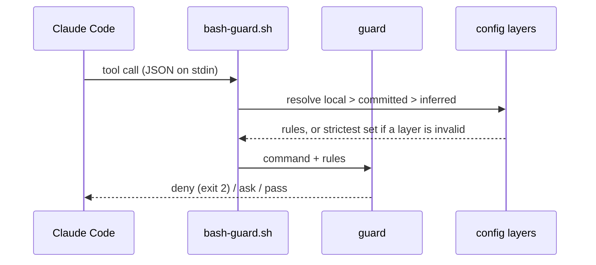

# How dw-sdlc works

The repository holds the software delivery process Dominik works by and the Claude Code tooling that
carries it: a plugin marketplace and the code behind it. Its first plugin, `guardrails`, is a set of
deterministic hooks that stop an agent session from doing the damage a human would not: rewriting
history, reading a secret, installing through the wrong package manager, committing sloppily. This
page is the long version of the README: how a guard judges a call, where its rules come from, how
the Gate runs, why the design is shaped this way, and how a plugin is adopted and released. Every guard in full is in the
[plugin README](../plugins/guardrails/README.md).

## How a guard judges a call

Every guard is a shell hook. Claude Code hands it the tool call as JSON on stdin before the call
runs, and the guard answers with one of three verdicts: deny (exit 2, the call never runs), ask (a
permission prompt), or pass (silent). Bash commands go through one dispatcher that parses the
payload once and spawns only the guards the command could trip.



## Where the rules come from

The rules come from the repository, not from the plugin. `.ai/agentic.config.json` declares the
package manager, protected branches, env-file policy and commit convention. A machine may add
`.ai/agentic.config.local.json` on top, which can tighten `guardrails` and never loosen it. Any key
neither file sets is inferred: pnpm from the lockfile, and the `conventional` commit convention. A
repository whose subjects start with a ticket key sets `commit.convention: ticket-key` in either file.
A linked worktree reads a layer it lacks from its main checkout, so a repository that keeps `.ai/` out
of git needs no copy per worktree. An invalid layer is dropped whole and the guards run on the
strictest set until it is fixed; the session start hook names each problem.

The guards judge the agent's tool calls only. A commit typed in a terminal meets the subject rule
through git's `commit-msg` hook: `hooks/commit-msg.sh` resolves the same config and refuses a subject
off the pattern. This repository runs it from `.husky/commit-msg`. The trailer stays the agent's
rule, since a commit a person writes has no co-author to name.

The plugin guards Node repositories, and App Store Connect from every repository: `asc` reaches the
whole store account from any directory. It carries no other stack-specific guard;
`packageManagers.ruby` is accepted by the schema and read by nothing.

## How the Gate runs

`pnpm check` is the Gate, the one command a change must pass, the same in a terminal and in CI. Its
script is `dw-sdlc gate`, the bin of the `dw-sdlc` package, which reads the `gate` key of the
resolved config. The Steps under `gate.steps` run in order from the repository root through `sh -c`,
each one's output passed through, and the first that fails ends the Gate. Then every Check under
`gate.checks` runs, and a failed Check does not stop the next: first a repository's own scripts,
which join through `gate.checks.run` as a `name` and a `command`, then the Checks the package ships.
The schema refuses a Check name the package does not ship. `gate.command` is the command an agent or
a person runs, inferred as `pnpm check` from the `check` script of `package.json` when no layer sets
it.

Every failure is one line naming the file where there is one, the rule and the remedy:

```text
.ai/agentic.config.json: config: gate.checks: unknown key "nope" — fix the file; the Gate runs once every layer is valid
step: "pnpm lint" exited 1 — fix what it printed above
```

Under GitHub Actions each line is also a workflow annotation on its file. `--json` prints the same as
one document on stdout, with the status, the resolved command, each Step and Check with its exit
code, and the failures; the commands' own output then goes to stderr. A Check the package ships runs
inside the bin, so its `command` is null. The exit code is 0 when everything passes, 1 when a Step or
a Check fails, and 2 when the Gate cannot run: an invalid config layer, a Step or Check whose command
the shell cannot find or execute, or a Check missing an input it reads. Why a Check is a named unit
turned on in the config is [ADR 0009](adr/0009-checks-are-named-units-turned-on-in-the-config.md).

### The Checks the package ships

A Check the package ships is `true` under `gate.checks` for its defaults, an options object over
them, or `false`; the schema's descriptions name each option and its default. Each is one module
under `packages/dw-sdlc/src/checks/`, one row of the list the Gate runs them in, and one key of the
schema.

- `primitives` holds the Primitives catalogue, `.ai/primitives.json`, to the tree: unique ids, a
  group that `groups` lists, a summary of one line within 120 characters, every `code` and `docs`
  path on disk with its heading anchor resolving, and every file under the roots named by the `code`
  of a Primitive, the file itself or a directory above it. The roots are `packages`, `plugins`,
  `scripts` and `src` by default; a test file needs no Primitive.
- `agents-map` holds `AGENTS.md` to 150 lines and 10240 bytes, to naming the resolved
  `gate.command`, to a Task Router row that points at the catalogue where there is one, and to every
  path the Task Router points at existing. Where the repository has them, it keeps the skills
  directory, `skills-lock.json` and the `.claude/skills` links in step.

`dw-sdlc primitives --paths <files>` answers from the same catalogue: for each path, the Primitives
whose `code` names it nearest, with their summaries and the documents to read, or that none does.

## Why this way

Each choice below is a one-paragraph decision record in `adr/`.

- **One plugin, not hooks copied into every repository.** Copies drift; a plugin gives one shared
  library and one line to enable. [ADR 0001](adr/0001-guards-ship-from-this-marketplace.md)
- **Policy is a validated config file, not prose.** A hook parsing a markdown rule is fragile; a JSON
  file against a schema is checked before it is trusted.
  [ADR 0002](adr/0002-agent-rules-are-a-validated-config-file.md)
- **An invalid layer runs the strictest set.** A typo must never quietly loosen a guard.
  [ADR 0003](adr/0003-invalid-config-layer-runs-strictest.md)
- **A lease push passes, a bare force push is refused.** Feature branches get rebased; protected
  branches take pull requests. [ADR 0004](adr/0004-lease-push-passes-bare-force-refused.md)
- **Env access is a list in the config, git as the fallback.** Some repositories track `.env` on
  purpose; a guard refusing every `.env*` by name blocks real work.
  [ADR 0005](adr/0005-env-access-is-a-list-in-the-config.md)

The repository's own supply chain follows the same idea: `pnpm-workspace.yaml` refuses any dependency
version younger than 7 days, exotic transitive sources and unlisted install scripts. The research
behind that and the plugin is in
[`research/agentic-guardrails/`](research/agentic-guardrails/agentic-guardrails.md).

## Adopting it in your repository

Add `.ai/agentic.config.json` and validate it with
`node <plugin root>/dw-sdlc/src/cli.ts config <file>`, where the plugin root is the `installPath` that
`claude plugin list --json` names. This repository's own file is the smallest useful example:

```json
{
  "$schema": "https://raw.githubusercontent.com/dominikwozniak/dw-sdlc/main/plugins/guardrails/config/agentic.config.schema.json",
  "version": 1,
  "packageManagers": { "node": "pnpm" },
  "guardrails": {
    "forcePush": "lease",
    "envFiles": { "policy": "git" },
    "protectedBranches": ["main"]
  },
  "commit": {
    "convention": "conventional",
    "trailer": "Co-Authored-By"
  },
  "gate": {
    "steps": ["pnpm lint", "pnpm format", "pnpm typecheck", "pnpm references:setup --check", "pnpm test"]
  }
}
```

A repository with nothing declared still gets the inferred defaults, so the file is optional. Each
key and its inferred value is described in the
[schema](../packages/dw-sdlc/config/agentic.config.schema.json). The `$schema` URL is an annotation
for editors; the guards always validate against the schema the plugin ships.

The `/sdlc-guardrails-setup` skill then writes this machine's local config layer from what it infers,
plus the commit convention when asked for one, excludes it from git, and adds a permission backstop
to `.claude/settings.local.json` plus the lease-push exception to `~/.claude/settings.json`. It shows
a dry run first, writes only what would change, and ends with the doctor: one PASS / WARN / FAIL line
per machine check. The doctor needs only Node 24 and runs from the installed plugin: in a terminal,
`node <plugin root>/dw-sdlc/src/cli.ts doctor` from the repository.

## From GitHub or from a clone

Added from GitHub with `--sparse .claude-plugin plugins packages`, the plugin is a snapshot of `main`
that `claude plugin update` refreshes, and the clone holds only the catalogue, the plugins and the
`dw-sdlc` package. Each plugin reaches the package through its `dw-sdlc` link, which
`claude plugin install` copies as a real directory, so a hook and a skill run the package's
`dw-sdlc` bin. A clone without `packages` installs the plugins without it: the guards then drop
every config layer and run strictest, and no command of the package starts. Added from a clone with
`claude plugin marketplace add ./`, it runs live from that checkout, a broken edit included.
The daily install is the GitHub one; a guard is developed through `pnpm test`, which runs every hook on
a real payload.

## How a change lands

`main` is protected in `.ai/agentic.config.json`, so a change reaches it through a pull request, and
`quality-gate.yaml` runs `pnpm check` on it first. For a small fix the agent commits on `main` and the
push comes from Dominik's own terminal: the guards judge only the agent's tool calls. GitHub branch
protection is not available on this private repository, so the guard is the only check.

## Releasing a plugin

`plugins/<name>/.claude-plugin/plugin.json` and `.claude-plugin/marketplace.json` carry one version
for a plugin, and `claude plugin update` refreshes an installed copy by that version only. A change
ships when both files are bumped in one `chore: release <name> x.y.z` commit that lands on `main`.
Installs from a clone see the change in the next session without a bump.

## Releasing the package

The `dw-sdlc` package goes to npm as JavaScript. Its source is TypeScript, and Node refuses to strip
types from a file under `node_modules`, so `pnpm pack` runs the package's `prepack`: `tsc` emits
`dist/` from `packages/dw-sdlc/tsconfig.build.json`. The manifest's `bin` and `exports` name the
source, so this repository's workspace link runs it as written; their twins under `publishConfig`
name `dist/`, and pnpm writes those into the packed manifest. `files` ships `dist/`, `config/` with the
schemas, and `templates/` with the Router the setup writes; the package has no runtime dependency. `test/pack.test.ts` packs it, installs
the tarball into a throwaway repository and runs `dw-sdlc gate` from that repository's `node_modules`.

A change to the package carries a changeset: `pnpm changeset` writes one under `.changeset/`, with
the bump and the line the changelog gets. On every push to `main`, `.github/workflows/release.yaml`
picks one of two modes:

- **version**, while a changeset is pending: it opens or updates the
  `chore(release): version packages` pull request, which bumps the version, writes `CHANGELOG.md`
  and deletes the changesets. GitHub opens it only when Settings → Actions → General allows GitHub
  Actions to create pull requests.
- **publish**, when npm lacks the version on `main`, which is what merging the version pull request
  makes true: one job runs `pnpm check` and packs the tarball with no secret in reach; the next
  publishes it, pushes the `dw-sdlc@x.y.z` tag and creates the GitHub release.

Merging the version pull request is the decision to release. The publish job signs in to npm by
trusted publishing, from its `id-token: write`, when the package's npm settings name
`dominikwozniak/dw-sdlc` and `release.yaml` as its trusted publisher; otherwise it signs in with the
`NPM_TOKEN` repository secret. npm sets a trusted publisher only on a package that exists, so a
version published before one is set needs the secret: a granular access token with read and write
access to packages, the bypass-2FA option on, and the shortest expiry that covers the release. What
npm lets such a token do, and until when, is in the
[research notes](research/gate/toolchain.md#npm-publishing).

Every publish carries a provenance attestation (`PNPM_CONFIG_PROVENANCE=true`), and npm attests only
a build from a public repository, so a publish from a private one fails rather than ship without
it. A consumer on `trustPolicy: no-downgrade` refuses a version that carries less trust evidence
than an earlier one, so the secret is deleted once trusted publishing works: a run that fell back to
it would publish a version those consumers refuse. A consumer takes a release through Dependabot
after the seven days of `minimumReleaseAge`; one that cannot wait names `dw-sdlc` in
`minimumReleaseAgeExclude` under its own rule for exclusions, as
[ADR 0008](adr/0008-gate-runs-from-a-pinned-package-plugin-adapts.md) records.
