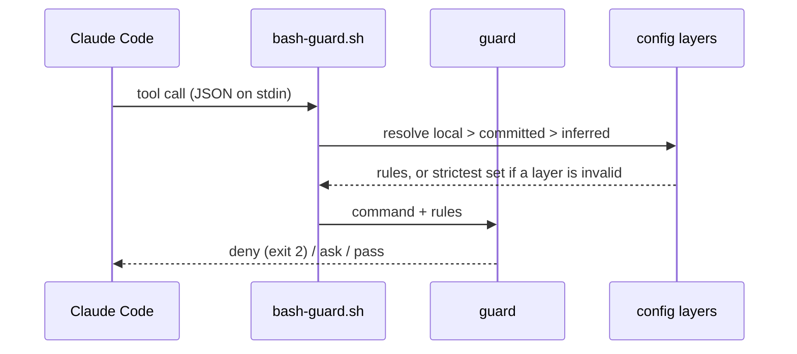

# How dw-sdlc works

The repository holds the software delivery process Dominik works by and the Claude Code tooling that
carries it: a plugin marketplace and the code behind it. Its first plugin, `guardrails`, is a set of
deterministic hooks that stop an agent session from doing the damage a human would not: rewriting
history, reading a secret, installing through the wrong package manager, committing sloppily. This
page is the long version of the README: how a guard judges a call, where its rules come from, why the
design is shaped this way, and how a plugin is adopted and released. Every guard in full is in the
[plugin README](../plugins/guardrails/README.md).

## How a guard judges a call

Every guard is a shell hook. Claude Code hands it the tool call as JSON on stdin before the call
runs, and the guard answers with one of three verdicts: deny (exit 2, the call never runs), ask (a
permission prompt), or pass (silent). Bash commands go through one dispatcher that parses the
payload once and spawns only the guards the command could trip.



## Where the rules come from

The rules come from the repository, not from the plugin. `.ai/agentic.config.json` declares the
package manager, protected branches, env-file policy and commit convention. A machine may add
`.ai/agentic.config.local.json` on top, which can tighten `guardrails` and never loosen it. Any key
neither file sets is inferred: pnpm from the lockfile, and the `conventional` commit convention. A
repository whose subjects start with a ticket key sets `commit.convention: ticket-key` in either file.
An invalid layer is dropped whole and the guards run on the strictest set until it is fixed; the
session start hook names each problem.

The guards judge the agent's tool calls only. A commit typed in a terminal meets the subject rule
through git's `commit-msg` hook: `hooks/commit-msg.sh` resolves the same config and refuses a subject
off the pattern. This repository runs it from `.husky/commit-msg`. The trailer stays the agent's
rule, since a commit a person writes has no co-author to name.

The plugin guards Node repositories, and App Store Connect from every repository: `asc` reaches the
whole store account from any directory. It carries no other stack-specific guard;
`packageManagers.ruby` is accepted by the schema and read by nothing.

## Why this way

Each choice below is a one-paragraph decision record in `adr/`.

- **One plugin, not hooks copied into every repository.** Copies drift; a plugin gives one shared
  library and one line to enable. [ADR 0001](adr/0001-guards-ship-from-this-marketplace.md)
- **Policy is a validated config file, not prose.** A hook parsing a markdown rule is fragile; a JSON
  file against a schema is checked before it is trusted.
  [ADR 0002](adr/0002-agent-rules-are-a-validated-config-file.md)
- **An invalid layer runs the strictest set.** A typo must never quietly loosen a guard.
  [ADR 0003](adr/0003-invalid-config-layer-runs-strictest.md)
- **A lease push passes, a bare force push is refused.** Feature branches get rebased; protected
  branches take pull requests. [ADR 0004](adr/0004-lease-push-passes-bare-force-refused.md)
- **Env access is a list in the config, git as the fallback.** Some repositories track `.env` on
  purpose; a guard refusing every `.env*` by name blocks real work.
  [ADR 0005](adr/0005-env-access-is-a-list-in-the-config.md)

The repository's own supply chain follows the same idea: `pnpm-workspace.yaml` refuses any dependency
version younger than 7 days, exotic transitive sources and unlisted install scripts. The research
behind that and the plugin is in
[`research/agentic-guardrails/`](research/agentic-guardrails/agentic-guardrails.md).

## Adopting it in your repository

Add `.ai/agentic.config.json` and validate it with `pnpm agentic:check <file>` from a checkout of this
repository. This repository's own file is the smallest useful example:

```json
{
  "$schema": "https://raw.githubusercontent.com/dominikwozniak/dw-sdlc/main/plugins/guardrails/config/agentic.config.schema.json",
  "version": 1,
  "packageManagers": { "node": "pnpm" },
  "guardrails": {
    "forcePush": "lease",
    "envFiles": { "policy": "git" },
    "protectedBranches": ["main"]
  },
  "commit": {
    "convention": "conventional",
    "trailer": "Co-Authored-By"
  },
  "validation": { "commands": ["pnpm check"] }
}
```

A repository with nothing declared still gets the inferred defaults, so the file is optional. Each
key and its inferred value is described in the
[schema](../plugins/guardrails/config/agentic.config.schema.json). The `$schema` URL is an annotation
for editors; the guards always validate against the schema the plugin ships.

The `/guardrails-setup` skill then writes this machine's local config layer from what it infers,
plus the commit convention when asked for one, excludes it from git, and adds a permission backstop
to `.claude/settings.local.json` plus the lease-push exception to `~/.claude/settings.json`. It shows
a dry run first and writes only what would change. `pnpm guardrails:doctor --root <path>`, run from a
checkout of this repository, prints one PASS / WARN / FAIL line per machine check.

## From GitHub or from a clone

Added from GitHub with `--sparse .claude-plugin plugins`, the plugin is a snapshot of `main` that
`claude plugin update` refreshes, and the clone holds only the catalogue and the plugins. Added from a
clone with `claude plugin marketplace add ./`, it runs live from that checkout, a broken edit included.
The daily install is the GitHub one; a guard is developed through `pnpm test`, which runs every hook on
a real payload.

## How a change lands

`main` is protected in `.ai/agentic.config.json`, so a change reaches it through a pull request, and
`quality-gate.yaml` runs `pnpm check` on it first. For a small fix the agent commits on `main` and the
push comes from Dominik's own terminal: the guards judge only the agent's tool calls. GitHub branch
protection is not available on this private repository, so the guard is the only check.

## Releasing a plugin

`plugins/<name>/.claude-plugin/plugin.json` and `.claude-plugin/marketplace.json` carry one version
for a plugin, and `claude plugin update` refreshes an installed copy by that version only. A change
ships when both files are bumped in one `chore: release <name> x.y.z` commit that lands on `main`.
Installs from a clone see the change in the next session without a bump.
