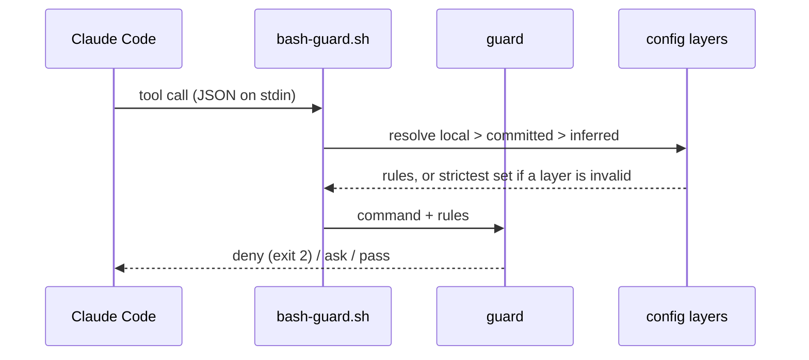

# How dw-sdlc works

The repository holds the software delivery process Dominik works by and the Claude Code tooling that
carries it: a plugin marketplace and the code behind it. Its plugin `sdlc` carries a set of
deterministic hooks that stop an agent session from doing the damage a human would not: rewriting
history, reading a secret, installing through the wrong package manager, committing sloppily. Beside
them it carries the Sync of a repository's References and the skills that set a repository up,
check a machine and ship a pull request. The plugin
[`sdlc-sessions`](../plugins/sdlc-sessions/README.md) depends on it and carries the skills that run a
session. This page is the long version of the README: how a guard
judges a call, where its rules come from, how the Gate runs, why the design is shaped this way, how
the plugin is adopted and released, and how the Ship script merges a pull request. Every guard in full is in the
[plugin README](../plugins/sdlc/README.md).

## How a guard judges a call

Every guard is a shell hook. Claude Code hands it the tool call as JSON on stdin before the call
runs, and the guard answers with one of three verdicts: deny (exit 2, the call never runs), ask (a
permission prompt), or pass (silent). Bash commands go through one dispatcher that parses the
payload once and spawns only the guards the command could trip.



## Where the rules come from

The rules come from the repository, not from the plugin. `.ai/agentic.config.json` declares the
package manager, protected branches, env-file policy and commit convention; `pr.merge`, who merges
a pull request the Ship script finds ready: the script under `auto`, the dev under `ask`, the
default; `pr.review`, the Review depth of a head no one has reviewed: `full`, `light`, `off`, or
`auto`, the default, which routes one from the changes; and `pr.reviewCommand`, the slash command
a `full` Review runs, `/code-review` by default. A machine may add `.ai/agentic.config.local.json`
on top, which can tighten `guardrails`, `pr.merge` and `pr.review` and never loosen them. It sets
`pr.reviewCommand` freely: the key has no strictness order. The `worker` key names how a Worker's
Claude Code session starts: `worker.command`, the words that start it before its own flags, `claude`
by default; `worker.model`, `sonnet`; and `worker.effort`, `high`, one of Claude Code's effort levels.
It has no strictness order either. The command belongs to one machine, so `dw-sdlc setup` writes
`cswap run -- --dangerously-skip-permissions` into the local layer when `cswap` is on PATH, and
leaves a command already there alone. Any key neither file sets is inferred: pnpm from
the lockfile, and the `conventional` commit convention. A repository whose subjects start with a
ticket key sets `commit.convention: ticket-key` in either file. A linked worktree reads a layer it
lacks from its main checkout, so a repository that keeps `.ai/` out of git needs no copy per
worktree. An invalid layer is dropped whole and the guards run on the strictest set, `pr.merge: ask`
and `pr.review: full` with it, until it is fixed; the session start hook names each problem.
`pr.reviewCommand` and `worker` stay as the valid layers name them.

The guards judge the agent's tool calls only. A commit typed in a terminal meets the subject rule
through git's `commit-msg` hook: `hooks/commit-msg.sh` resolves the same config and refuses a subject
off the pattern. This repository runs it from `.vite-hooks/commit-msg`, a Vite+ git hook. The trailer
stays the agent's rule, since a commit a person writes has no co-author to name.

The plugin guards Node repositories, and App Store Connect from every repository: `asc` reaches the
whole store account from any directory. It carries no other stack-specific guard;
`packageManagers.ruby` is accepted by the schema and read by nothing.

## How the Gate runs

`pnpm check` is the Gate, the one command a change must pass, the same in a terminal and in CI. Its
script is `dw-sdlc gate`, the bin of the `dw-sdlc` package, which reads the `gate` key of the
resolved config. The Steps under `gate.steps` run in order from the repository root through `sh -c`,
and the first that fails ends the Gate. Then every Check under `gate.checks` runs, and a failed Check
does not stop the next: first a repository's own scripts, which join through `gate.checks.run` as a
`name` and a `command`, then the Checks the package ships. The schema refuses a Check name the
package does not ship. `gate.command` is the command an agent or a person runs, inferred as
`pnpm check` from the `check` script of `package.json` when no layer sets it.

The Gate is quiet in a terminal and for an agent alike, so its whole report fits in what an
agent's Bash tool shows. A Step or run script runs with its two output streams captured into one, in
the order written, and prints none of it when it passes. A green run prints one line per Step with
its time, one per Check and a last line saying it is green:

```text
gate: step pnpm test — pass (71 s)
gate: check primitives — pass
gate: green — 3 steps, 8 checks
```

A Step or run script that does not pass prints its last 50 lines, indented, under its own line; the
Steps after a failed one do not run and print nothing. A Check the package ships prints `— failed`
or `— cannot run`. Then every failure is one line naming the file where there is one, the rule and
the remedy, and a last line ends the report:

```text
gate: step pnpm exec vp check — pass (4 s)
gate: step pnpm test — failed, exit 1 (71 s); its last 50 lines:
  …
  ✖ failing tests:
  …
step: "pnpm test" exited 1 — fix what it printed above; run it alone for the full output
gate: failed — 1 failure
```

No file keeps the full output: the failure line names the command to run alone. In a terminal a
Step's line shows when it starts and takes its result in place when it ends; elsewhere each line
prints once, finished. `--verbose` passes each command's output through live instead, colours kept,
under a `gate: step <command>` or `gate: check <name>` line, and keeps no tail. The Quality Gate
workflow runs it this way, so the log of a job that times out shows how far the tests got.

SIGINT or SIGTERM sent while a command runs, from Ctrl-C or a cancelled CI job, stops that command
and every command and Check after it, and the report still prints: the stopped command's last 50
lines, its failure line, `"<command>" was stopped by SIGINT`, and the last line. A second signal ends
the Gate at once, for a command that ignores the first. The Checks the package ships run inside the
bin, where a signal ends the Gate at once.

Every Step runs under watch for Drift. Before and after each Step the Gate records the content of
every file git tracks or would track, hashed with `git write-tree` over a copy of the index, and
each file the Step created, changed or deleted is one failure:
`packages/x/package.json: drift: "pnpm build" changed it — commit the change, or make the Step only read`.
The records are taken around each Step, never against `HEAD`, so an edit made before the run never
drifts, and an ignored file, such as build output under `dist/`, is never recorded. Nor is a tracked
file marked `--assume-unchanged` or `--skip-worktree`, which `git add` passes over. Drift does not
stop the Steps after it or the Checks, so one run names every Step that writes. A Step a signal
stopped is not compared. A stale generated file then fails a local `pnpm check` as it fails a
`git diff --exit-code` in CI. A tree the Gate cannot record, such as a directory outside git, means
the Gate cannot run. `gate.drift: "allow"` turns the watch off, for a repository whose Steps must write
while it fixes them.

An invalid config layer runs nothing and fails as
`.ai/agentic.config.json: config: gate.checks: unknown key "nope" — fix the file; the Gate runs once every layer is valid`.

Under GitHub Actions each failure line is also a workflow annotation on its file. `--json` prints the
document alone on stdout: the status, the resolved command, each Step and Check with its exit code and
its `tail`, and the failures. `tail` is the last 50 lines of a Step or run script that did not pass,
and null otherwise. A Check the package ships runs inside the bin, so its `command` and its `tail`
are null. With `--verbose` the commands' output goes to stderr and every `tail` is null. The exit
code is 0 when everything passes, 1 when a Step or a Check fails or a Step drifts, and 2 when the
Gate cannot run: an invalid config layer, a Step or Check whose command the shell cannot find or
execute, a Check missing an input it reads, such as a Ratchet's baseline, or a tree it cannot record
for Drift. Why a Check is a named unit turned on in the config is
[ADR 0009](adr/0009-checks-are-named-units-turned-on-in-the-config.md).

### The Checks the package ships

A Check the package ships is `true` under `gate.checks` for its defaults, an options object over
them, or `false`; the schema's descriptions name each option and its default. Each is one module
under `packages/dw-sdlc/src/checks/`, one row of the list the Gate runs them in, and one key of the
schema.

- `primitives` holds the Primitives catalogue, `.ai/primitives.json`, to the tree: unique ids, a
  group that `groups` lists, a summary of one line within 120 characters, every `code` and `docs`
  path on disk with its heading anchor resolving, and every file under the roots named by the `code`
  of a Primitive, the file itself or a directory above it. The roots are `packages`, `plugins`,
  `scripts` and `src` by default; a test file needs no Primitive.
- `agents-map` holds `AGENTS.md` to 10240 bytes, to naming the resolved `gate.command`, to a Task
  Router row that points at the catalogue where there is one, and to every path the Task Router
  points at existing. It holds `CLAUDE.md` at the root to a symbolic link to the map by its path
  from the root, so Claude Code reads the map the Gate judges; a map named `CLAUDE.md` needs no
  link. Where the repository has them, it keeps the skills directory, `skills-lock.json` and the
  `.claude/skills` links in step.
- `routed-docs` fails each document under `docs/` that no Task Router row and no Primitive's docs
  reach, so a task leads an agent to every document that explains it. A row reaches a document
  through a code span in a cell after the first that names it, a directory above it or a glob that
  matches it; a Primitive reaches the documents its `docs` name, the heading anchor dropped.
  Research notes, `docs/research/**`, are exempt by default: they are read through the spec they
  back. It reads the map `agents-map` reads and the catalogue `primitives` reads, each Check on or
  off, and never a document's prose. A map with no Task Router table fails once on the map, a
  missing map leaves the Gate unable to run, and a catalogue that is missing or invalid reaches
  nothing.
- `markdown-budget` holds each file a glob matches to that glob's byte budget, by default the agent
  docs, `docs/agents/*.md`, to 6144 bytes. A list of budgets replaces the default, such as one that
  adds `GLOSSARY.md` at a budget of its own; no default names a glossary, since a glob that matches
  no file fails. Neither `agents-map` nor `markdown-budget` counts lines: each holds a file's size in
  bytes.
- `markdown-refs` fails a relative link or image whose path is not a file or directory of the
  repository, or whose heading anchor names no heading of the markdown file it points at. A link
  with a scheme, such as `https:`, and a link inside code are not judged.
- `temporal-language` fails a changelog phrase in a durable document: the list kody's docs check
  holds, as [the research notes](research/gate/kody.md#two-checks-read-whole) record it, such as
  `we now`, `is now the` or `no longer supports`, matched across a line break and never inside code.
  Decision records, research notes and changelogs record a point in time, so `docs/adr/`,
  `docs/decisions/`, `docs/research/` and every `CHANGELOG.md` are exempt by default.
- `decision-records` holds the records under `docs/adr`, or the template's `docs/decisions`, to
  files named `<number>-<slug>.md`, numbered from 1 with no gap and no number taken twice, each with
  a level-1 heading for its title and a frontmatter `status` whose first word is `proposed`,
  `accepted`, `active`, `deprecated` or `superseded`. Its `fields` option holds each record to more
  of its frontmatter, and names no field by default. `date` is a `YYYY-MM-DD` day. Under `touches`,
  a record in force, `accepted` or `active`, names the paths it governs. Each is a file or directory
  git tracks or would track, or a glob that matches such a file. A `superseded` record names none.
  Under `superseded-by`, a `superseded` record names the number of each record that replaces it.
  Each number under `amended-by` is the number of a record in the same directory. A list is
  comma-separated after its key, or one `- ` item a line under it.
- `file-size-ratchet` is a Ratchet over code. It holds each file to the line limit of the first
  group whose glob matches it: `tests` 2000, `source` 500. A file over its limit passes only when
  the committed baseline, `.ai/file-size-ratchet.baseline.json`, lists it, and then only up to the
  count recorded there. A baseline that lists a file twice, at a count within its group's limit or
  in no group fails the Check. No default group holds markdown: the byte budgets above are fixed,
  so a long map has to shrink, where a baseline would record it as it stands.
- `comment-budget` holds each comment block in the JavaScript, TypeScript and shell (`.sh`) under
  `packages`, `plugins`, `scripts` and `src` to 3 lines of prose. A block is one `/* … */` comment or
  a run of `//` or `#` lines, each alone on its line; a comment after code is none. In shell, a `#`
  opens a comment only where it starts a word of code: never inside a quote, a `${…}`, an arithmetic
  `((…))` or a heredoc body, and the shebang on line 1 is none.

The Checks that read many files judge the ones git tracks or would track, never one it ignores, so a
link to an ignored file, or to another case of a file's name, fails on a Mac as it fails in CI. A
glob's `*` and `**` skip a name that starts with a dot, as a shell does: `**/*.md` leaves the
vendored skills under `.agents/` out.

`dw-sdlc gate --update-baseline` runs the Gate, then rewrites the baseline of each Ratchet, only
when every Step and every other Check passed and no Step drifted. It only tightens: a file within
its limit leaves the list, a count that shrank is lowered, and no file joins. Where there is no
baseline it records one, every file over its limit at its count, unless HEAD holds one the tree
lost: that one is restored with git, never recorded again. A refused refresh leaves the file byte
for byte as it was.

`dw-sdlc gate --cache` skips the run when the working tree holds what it held at the last green run
in this checkout, and the same version of dw-sdlc runs the same resolved Gate. A pre-push hook that
runs the Gate then costs nothing on an unchanged tree. The tree is hashed with `git write-tree` over
a copy of the index, after `git add -A` on the copy. The real index is never touched. Untracked
files count and ignored files do not, and the same content still matches once it is committed,
amended or rebased. What a Step or a Check reads outside the tree, such as `node_modules`, the
environment or `HEAD`, is not part of the hash, and neither is an uncommitted edit inside a
submodule. The stamp is `dw-sdlc-gate.green` in the checkout's own git dir, so each worktree keeps
its own. It holds the hash taken before the run, so a Gate that changes the tree runs again next
time. A tree the cache cannot hash, such as a directory outside git, runs the whole Gate behind a
line saying why. A cached run prints `gate: green — cached, the tree matches the last green run`,
and under `--json` a green document with `cached: true` and no Step or Check. Without the flag
nothing is skipped and nothing stamped, and `--cache` does not combine with `--update-baseline`.

`dw-sdlc check <name>` runs one Check of the Gate alone, so a person iterates on one Check and a
skill reads one result. The name is a script under `gate.checks.run` or a Check the package ships; a
name both carry runs both, as the Gate does. No Step runs and no other Check. A shipped Check runs
on the setting `gate.checks` gives it, and on its defaults where the config sets it `false` or
leaves it out, so a Check can be tried before it is turned on. Its lines, its exit codes and its
`--json` document are the Gate's, the document with no Step; it prints no line of its own for a
Check that passes, and a run script that does not pass prints its last 50 lines. It takes no
`--update-baseline`: a refresh needs every other Check to pass, and only the Gate runs them.

`dw-sdlc primitives --paths <files>` answers from the same catalogue: for each path, the Primitives
whose `code` names it nearest, with their summaries and the documents to read, or that none does.

## Why this way

Each choice below is a one-paragraph decision record in `adr/`.

- **One plugin, not hooks copied into every repository.** Copies drift; a plugin gives one shared
  library and one line to enable. [ADR 0001](adr/0001-guards-ship-from-this-marketplace.md)
- **The guards, the Sync and the `sdlc` skills are that one plugin.** One `enabledPlugins` line and one
  version cover a machine, and a machine takes every part or none.
  [ADR 0010](adr/0010-one-sdlc-plugin-carries-guards-sync-and-gate.md)
- **The session helpers are a plugin of their own.** They are work the dev starts, not protection on
  every tool call, and they depend on `sdlc`, so a session keeps its guards.
  [ADR 0014](adr/0014-session-helpers-ship-as-sdlc-sessions-beside-sdlc.md)
- **Policy is a validated config file, not prose.** A hook parsing a markdown rule is fragile; a JSON
  file against a schema is checked before it is trusted.
  [ADR 0002](adr/0002-agent-rules-are-a-validated-config-file.md)
- **An invalid layer runs the strictest set.** A typo must never quietly loosen a guard.
  [ADR 0003](adr/0003-invalid-config-layer-runs-strictest.md)
- **A lease push passes, a bare force push is refused.** Feature branches get rebased; protected
  branches take pull requests. [ADR 0004](adr/0004-lease-push-passes-bare-force-refused.md)
- **Env access is a list in the config, git as the fallback.** Some repositories track `.env` on
  purpose; a guard refusing every `.env*` by name blocks real work.
  [ADR 0005](adr/0005-env-access-is-a-list-in-the-config.md)

The repository's own supply chain follows the same idea: `pnpm-workspace.yaml` refuses any dependency
version younger than 7 days, exotic transitive sources and unlisted install scripts. The research
behind that and the plugin is in
[`research/agentic-guardrails/`](research/agentic-guardrails/agentic-guardrails.md).

## Adopting it in your repository

Run `/sdlc-setup` in the repository. It sets the repository and the machine up, a dry run first,
and writes only what would change. In a repository with a `package.json` it adopts the Gate. It asks
before it adds `dw-sdlc` as a devDependency, naming the version it pins, the one the plugin runs,
and stops on a no. On a yes it pins the package and runs the install. The committed
`.ai/agentic.config.json` gains a `gate` key when it has none, created when absent; a `gate` key it
has stays. The key turns on `markdown-refs`, `temporal-language` and `comment-budget`, which judge
the tree as it is, and `agents-map`, which reads the map the user writes. Every other Check is
`false`, since each reads an input the repository adds first: a catalogue, a records directory, the
docs a glob matches, a Task Router row or Primitive for each doc, a Ratchet's baseline. The setup
never writes `AGENTS.md`: the first `dw-sdlc gate` names what the map lacks through `agents-map`.
The Ratchet joins once the Gate is green: `file-size-ratchet` set to `true`, then
`dw-sdlc gate --update-baseline` records the baseline to commit.

For the machine, the setup writes the local config layer from what it infers, plus the commit
convention when asked for one, excludes it from git, and adds a permission backstop to
`.claude/settings.local.json` plus the lease-push exception to `~/.claude/settings.json`. Where those
settings still enable `guardrails@dw-sdlc` or `references@dw-sdlc`, it prints the `enabledPlugins`
edit and leaves it to the user. It ends with the doctor, one PASS / WARN / FAIL line per machine
check, and after a run that wrote the `gate` key, with one Gate run. The doctor needs only Node 24
and runs from the installed plugin: `/sdlc-doctor` in a session, or
`node <plugin root>/dw-sdlc/src/cli.ts doctor` from the repository in a terminal.

The rules a repository wants beyond the Gate go in the same `.ai/agentic.config.json`; validate it
with `node <plugin root>/dw-sdlc/src/cli.ts config <file>`, where the plugin root is the
`installPath` that `claude plugin list --json` names. This repository's own file is the smallest
useful example:

```json
{
  "$schema": "https://raw.githubusercontent.com/dominikwozniak/dw-sdlc/main/plugins/guardrails/config/agentic.config.schema.json",
  "version": 1,
  "packageManagers": { "node": "pnpm" },
  "guardrails": {
    "forcePush": "lease",
    "envFiles": { "policy": "git" },
    "protectedBranches": ["main"]
  },
  "commit": {
    "convention": "conventional",
    "trailer": "Co-Authored-By"
  },
  "gate": {
    "steps": ["pnpm exec vp check", "pnpm references:setup --check", "pnpm test"]
  }
}
```

A repository with nothing declared still gets the inferred defaults, so the file is optional. Each
key and its inferred value is described in the
[schema](../packages/dw-sdlc/config/agentic.config.schema.json). The `$schema` URL is an annotation
for editors; the guards always validate against the schema the plugin ships.

## From GitHub or from a clone

Added from GitHub with `--sparse .claude-plugin plugins packages`, the plugin is a snapshot of `main`
that `claude plugin update` refreshes, and the clone holds only the catalogue, the plugins and the
`dw-sdlc` package. The plugin reaches the package through its `dw-sdlc` link, which
`claude plugin install` copies as a real directory, so a hook and a skill run the package's
`dw-sdlc` bin. A clone without `packages` installs the plugin without it: the guards then drop
every config layer and run strictest, and no command of the package starts. Added from a clone with
`claude plugin marketplace add ./`, it runs live from that checkout, a broken edit included.
The daily install is the GitHub one; a guard is developed through `pnpm test`, which runs every hook on
a real payload.

## How a change lands

`main` is protected in `.ai/agentic.config.json`, so a change reaches it through a pull request, and
`quality-gate.yaml` runs `pnpm check` on it first. For a small fix the agent commits on `main` and the
push comes from Dominik's own terminal: the guards judge only the agent's tool calls. GitHub branch
protection is not available on this private repository, so the guard is the only check.

## How the Ship script merges a pull request

The Ship script, `dw-sdlc pr ship [<n>]`, drives one pull request to merged. A call reads the pull
request's state through `gh` in one GraphQL query and decides the one Action it needs next. When that Action
is the script's own, the call performs it, reads again and decides again; it answers the first
Action that is not, as one line or, with `--json`, one document. The exit code says whose turn it
is: 0 done, 10 the agent's, 20 wait, 30 the dev's, 2 it cannot run. The script holds no state
between calls and never sleeps: a `wait` carries `recheckAfter`, the seconds until the next call.

The script owns four Actions, one `gh` command each. It updates a branch behind its base by
merging the base in. It judges "behind" itself, from the compare of the base with the head: a head
that lacks one commit of the base or more is behind, and so is one GitHub reports `BEHIND`. GitHub
reports `BEHIND` only where a rule asks a branch to be up to date before it merges, so without the
compare a branch behind its base would merge with no CI run on the tree the merge makes. It marks
the head of the viewer's own pull request reviewed when the Review depth is `off`. It marks the
viewer's own draft ready once CI is green, no thread is open and the head is reviewed. It squash
merges with `--match-head-commit`, so a push during the decision never merges blind. Each runs at
most once per call; one that comes round again, and every one under `--dry-run`, parks with its
command for the dev.

`performed` lists each Action a call ran, with `ok`, `exit` and `stderr` when `gh` wrote any. `ok` is
whether the read after the Action shows its effect; `exit` is what `gh` answered. The pair `ok: false`
with `exit: 0` means `gh` accepted the Action and the read does not show it yet, and the reason says
so. An update counts when the head carries the base read before it, not for a moved head alone. A
`mark-reviewed` whose head moved names both heads. When the read after an Action fails, the call exits
2 and names each Action that ran with `gh`'s exit, and `--json` puts them under `performed`: the
Action may have landed, so a caller does not run it blind again.

The agent owns four: `fix-conflicts`, `fix-ci`, `address-review` and `review`. Under `details`,
`fix-ci` lists each failing check with its link and, for a GitHub Actions job, the command that
prints its log; `address-review` lists each open thread someone else commented on last, and with
none answers a review that requests changes. Every later Action that holds the pull request back
rides in `blockers`, so one push can fix several. The dev owns the rest: a closed pull request, a
head no check reported on within 120 s of its commit date, CI pending past its 40-minute budget, a
thread whose last comment is the viewer's and so awaits the reviewer, another author's draft, which
is the author's to mark ready, a required approval, three Reviews with no success between them, and
the merge when it is not the script's.

Who merges follows `pr.merge`: the script under `auto`, the dev under `ask`, and the script for one
call under `--merge`. A pull request another author opened needs no Review, since the dev merges it.
Once nothing else holds it back, it parks for the dev under all three. A Review is clean when it
reports no Finding: a concrete harm the pull request's own changes cause, a miss against the spec,
or a bug fix without its regression test. The agent declines the rest with a line each in the
Recap, and lists a harm outside the change as a follow-up. A clean review is a commit status:
`dw-sdlc pr reviewed <n> --head <sha>` posts `dw-sdlc/review` in state `success` on the head the
review read and refuses once a push moved it, so a new head needs a fresh review. A Review that
leaves a Finding open is pinned too: `--findings` posts the same status in state `failure`,
described `read, findings open`, the read mark. The mark sits on a head the fix then leaves behind,
so the head of the pull request never shows it from an earlier round. Three Reviews with no
success between them park the pull request, as the next paragraph says. Contexts under
`dw-sdlc/` never count as CI. The script never deletes a branch: a merged pull request answers
`done` with the deletion command for the dev.

The Review limit is 3, a constant with no config key, so no repository turns the loop back on. The same
GraphQL query counts the read marks on the commits after the last review success of any kind: a
clean one, one the script posted under `off` and the dev's acceptance all start the count again. The
head's own read mark counts too. When the head has no success and the count is 3 or more, the answer
is `park review-limit`, actor `dev`, in the place of `act review`, under `--dry-run` too and at
`full` and `light` alike. Its reason names the Reviews and the commit they count from, and its
command is `dw-sdlc pr reviewed <n> -R <owner/name> --head <head> --accept`. `--accept` posts
`dw-sdlc/review` in state `success`, described `accepted by the dev, findings open`, so the
status never presents an accepted pull request as cleanly reviewed; with `--findings` it exits 2.
Only the dev runs it. The agent prints the reason, the Findings the last fix answered and the command,
and stops. The dev's `--review <depth>` on the call answers `act review` past the limit, for that
call only; a fourth Review that leaves a Finding open posts a fourth read mark, so the next call
without the flag parks again. The limit counts only Reviews of the viewer's own pull request, and a
depth of `off` has none to count.

How closely a head is read is its Review depth: the dev's `--review full|light|off` for one call,
else `pr.review`, and `details` names it under `depth` and where it came from under `source`, `flag`,
`config` or `auto`. Under `full` the agent reviews the head with the slash command `pr.reviewCommand`
names, which `details.reviewCommand` carries. Under `light` one `sdlc-reviewer` subagent the plugin
ships reads the diff at medium effort. Under `off` no one reads it: the script posts the
`dw-sdlc/review` success itself as `mark-reviewed`, its description `off: --review off` or
`off: pr.review`, so a green pull request merges with no agent turn. Every other row holds at every
depth: conflicts, failing CI, threads and who merges.

Under `pr.review: auto`, the default, built-in rules route the depth from the changes the Review
would read, so the same change always gets the same depth. The script reads them through one more
`gh api` call, GitHub's compare from `details.since`, else from the base, to the head, only when a
Review awaits the viewer's own head and no carry applies. Each file counts its added and removed
lines. The rules, first match wins:

- `off`: every changed file is a lockfile, as `pnpm-lock.yaml` or `Gemfile.lock` in any directory.
  The status reads `off: lockfiles only`.
- `full`: a change the script cannot size: 300 files, GitHub's compare limit, which may hold some
  back, or a file outside lockfiles the compare shows no patch for, such as a binary one. A file
  under `.github/workflows/`, under its name or its name before a rename. More than 100 changed
  lines outside lockfiles.
- `light`: the rest.

`source` is then `auto`, and `details.reviewCommand` comes at every depth: the agent may raise a
`light` it judges riskier than its size to `full`, saying why in one line. An `off` the rules route
the script posts in the same call, so no agent turn comes to raise it. The agent never lowers a
depth, and never raises one the dev or the config set. No config key moves the rules. An invalid layer
runs `full`, and the local layer may tighten `pr.review` in the order full, auto, light, off.

After a push, the Review reads only what changed since the head the last Review read. The same
GraphQL query reads the pull request's last 100 commits. The last one before the head with a
`dw-sdlc/review` success or a read mark goes under `details.since`, the point the Review reads from
and `auto` routes from. A success the script posted under `off` does not count, since no one read
that head. So the Review after a fix reads the fix alone, at the depth `auto` routes on the fix's
own size, and the agent names to it the Findings that fix answers. A rebase or a force push drops
the read commit from the history, and 100 later commits push it out of the read. Then no
`details.since` comes, and the Review reads the whole diff since the base. After a merge of the base
in, the changes since `details.since` include what the base brought in, and `auto` counts them too.

A head that only merged the base in carries the earlier success. A read mark never carries: the
Findings it records still stand. A read mark with only merges after it is passed over, since no fix
answers its Findings yet and the changes since it are only the base's. `details.since` then names
the read before the mark, else none, so the Review reads again the changes the mark's Review read
and finds the open Findings, even in a session that never saw them. Two tests tell a merge from the
branch's own changes, and both must pass for a carry:

- Every commit after the reviewed one, the head included, is a merge. The GraphQL query reads each
  commit's parent count.
- The pull request's own changes are the same at the head as at the reviewed commit. The script
  reads GitHub's compare from the base's head to each of the two commits. That takes two `gh api`
  calls and no checkout. Each compare is the diff the pull request shows. Both must list the same
  files, with the same status and names, and the same added and removed lines in the same order.
  Hunk positions and context lines are left out, since a base that moved shifts them.

When both pass, the script posts the status as `mark-reviewed`, described as `carried from <sha>`,
and its `details` name only `since`: a carry reads at no depth. A depth the dev names for the call
beats the carry: `--review full` or `light` asks for a Review of the whole diff since the base, and
`--review off` posts the status as `off: --review off`. A conflict resolved by hand changes the
branch's own lines, so it never carries. Neither does a file the compare shows no patch
for, such as a binary one, or a compare at GitHub's limit of 300 files. A merge made by hand that
moves one of the branch's own lines within a file, keeping their order, does carry: the test leaves
positions out.

The `sdlc-pr-ship` skill is the agent's side: it calls the script, does the agent's Action, calls
again, and stops at a wait, a park or done, as the
[plugin README](../plugins/sdlc/README.md#shipping-a-pull-request) describes. The dev starts it, or a
Worker whose Brief tells it to, as `templates/brief.md` of
[`sdlc-sessions`](../plugins/sdlc-sessions/README.md#the-brief) words it; `pr.merge` decides the merge
either way.

## How a Lead runs Workers

A Lead hands each Brief to a Worker in a herdr terminal through three commands, tested against a fake
`hc` and a fake `herdr-app` the way the Ship script is tested against a fake `gh`. They run only in a
terminal herdr started: `$HC_TERMINAL_ID` is the Lead's address, and without it each command exits 2.

- `dw-sdlc worker start --brief <file> --name <name>` runs `hc run` in the background with the name, the
  label `role=worker`, `--outlive-parent` and the repository as the folder. The command that follows is
  `worker.command` of the config, then `--worktree <name>`, `--model`, `--effort` and the Brief as the first
  message. The flags default to `worker.model` and `worker.effort`. It refuses a fourth live Worker of the
  same Lead; `--max-workers` raises the limit. When the Lead sits in a herdr space, the Worker joins it, and
  the command renames its tab, which herdr numbers, to the Worker's name. The folder is the main checkout,
  also when the Lead sits in a linked worktree. The Brief travels as an argument of the Worker's command, so
  herdr keeps no `first_message` for it; the command reads the terminal for up to `--wait` seconds (30) until
  the Worker's status turns `working`, `blocked` or `done`. It exits 1 when herdr reports the first message
  unsent, the terminal has ended, the Worker reports an error or it shows no work in time. It never sends the
  Brief again: the Lead reads the terminal first.
- `dw-sdlc worker ls` lists the Lead's Workers: name, address, herdr's state, status and folder. The status
  is what the Worker reports, or `finished` once its terminal has ended. herdr's `done` means a turn ended,
  not the task: the Worker's Recap says whether the task is done.
- `dw-sdlc worker report --to <lead> --recap <file>` sends a one-line Recap as itself and a longer one as the
  path of its file. `hc send` exits 9 while the Lead is blocked on a dialog. The command then waits
  `--interval` seconds (60) and sends again, up to `--attempts` times (30), and exits 1 when the Lead is
  still blocked. It never passes `--force`, since typing into a blocked terminal may answer its dialog.

## How a Sweep removes what finished work leaves

`dw-sdlc sweep [--dry-run] [--json]` removes the worktrees and the local branches finished work leaves
behind. The dev's word starts it, and it runs from the main checkout: in a linked worktree it exits 2 and
names the line to run from the main checkout, since git run inside the command is out of sight of Claude
Code's worktree isolation. [ADR 0015](adr/0015-a-sweep-deletes-only-what-the-guards-let-an-agent-delete.md)
sets its bounds: it never forces, and it never writes to a remote.

- It fetches origin first, so a branch squash-merged since the last fetch counts. The fetch writes
  remote-tracking refs only; origin's own refs stay as they were.
- It reads the base as the guard does: `baseBranch` of the config, else the branch `origin/HEAD` names. With
  no base it exits 2 and removes nothing.
- A linked worktree goes when its whole set passes, wherever it lies: Claude Code's worktree folder, beside
  the checkout or in an old session's scratchpad. The set: no modified or untracked file, ignored files such
  as installed dependencies aside; no paused rebase, merge, cherry-pick, revert or bisect; no lock but a
  stale Claude Code one; its HEAD Landed, on a branch or detached. It removes the worktree without force,
  then deletes the branch that worktree had checked out, in the same run. The main checkout is never
  removed.
- Claude Code locks the worktree of a session with the reason `claude session <name> (pid <N> start
  <time>)`, the time being the process's start in UTC as `ps -o lstart` writes it; local time reads as well,
  so a live lock is never taken for stale over a time zone. The lock is stale when no process N runs, or when N started at another time, as a reused pid
  does. The Sweep lifts a stale lock just before it removes the worktree, and only when the rest of the set
  passes; if git then refuses the removal, it puts the lock back. A live lock keeps the worktree, named by
  its pid. A lock with any other reason keeps it too, with the reason and `git worktree unlock` as the
  command for the dev to run. A lifted lock is an item of kind `lock` in `removed`, just before its worktree.
- A worktree that fails the set stays, with its reason: the files that hold it, with the forced removal as
  the command for the dev to run; the paused operation; the lock's reason; a HEAD that is not Landed. A worktree git refuses to remove stays with git's words, its branch with it, and
  the Sweep goes on.
- In herdr (`$HC_TERMINAL_ID` set) it also reads terminals, with `hc`: the sweeping session's Workers, the
  terminals whose parent is its own, read as `worker ls` and `recap` read them, finished ones included, and
  every other live terminal, each with the folder it works in. A Worker whose status is none of working,
  blocked or unknown, the last being a Worker yet to report, is stopped (`hc kill`) and then removed (`hc
  rm`) when its worktree goes in the same Sweep: the Worker's terminal, the stale lock, the worktree, then
  its branch. The worktree is judged whole first, so a Worker beside a dirty worktree is never stopped. A
  Worker whose folder is already gone could commit nothing, so it goes under the same status rule. A finished
  Worker of the sweeping session is removed, never stopped. Another session's terminal in a worktree keeps
  that worktree, named with the terminal's address and place and `hc kill` as the command for the dev to run;
  the sweeping session's own terminal is never stopped and keeps its worktree too. Outside herdr no terminal
  is read and the output says so. In herdr an `hc` that fails ends the Sweep with exit 2 before any removal; a
  stop or removal that fails later keeps the Worker's worktree, with `hc`'s words, and the Sweep goes on.
- A branch goes when it is Landed (see [`GLOSSARY.md`](../GLOSSARY.md)). `packages/dw-sdlc/src/landed.ts`
  follows the guard's rule in `lib-git.sh`: the tip is on the base, or a base commit since the fork holds the
  tip's tree or the verbatim patch-id of its whole diff. It reads the same 5000 base commits and only local
  objects. The guard keeps its own bash version; one table of scenarios,
  `plugins/sdlc/test/landed-scenarios.ts`, which both suites read, holds the two to one meaning.
- It keeps the default branch, the base branch, a protected branch and a branch a kept worktree has checked
  out, each with its reason. A branch whose work is on no commit of the base stays, with the forced delete
  as the command for the dev to run. A delete git refuses is kept with git's words, and the Sweep goes on.
- One line an item, or one document with `--json`: `terminalsRead`, `removed` and `kept`, each item with its
  kind (branch, worktree, lock or terminal), name (a worktree's path, a terminal's address), reason and, for
  a kept one, the dev's command. `--dry-run` removes and stops nothing and answers the same items. Exit 0 when nothing is kept but the default, the base or a protected
  branch, which are never the dev's to decide and are still listed; 1 when something else is; 2 when it
  cannot run.

## Releasing the plugin

`plugins/sdlc/.claude-plugin/plugin.json` and its entry in `.claude-plugin/marketplace.json` carry
one version, and `claude plugin update` refreshes an installed copy by that version only. A change
to any part of the plugin ships when both files are bumped in one `chore: release sdlc x.y.z` commit
that lands on `main`. Installs from a clone see the change in the next session without a bump.

The plugin's version is its own, apart from the package's: a release of one never bumps the other.
Where the two meet, the doctor's `package` line names a drift between the `dw-sdlc` the plugin links
and the one a repository pins.

`sdlc-sessions` releases the same way, on a version of its own, in a `chore: release sdlc-sessions x.y.z`
commit. The doctor's `sessions` line names a drift between its copy of `dw-sdlc` and the copy `sdlc` runs.

## Releasing the package

The `dw-sdlc` package goes to npm as JavaScript. Its source is TypeScript, and Node refuses to strip
types from a file under `node_modules`, so `pnpm pack` runs the package's `prepack`: `tsc` emits
`dist/` from `packages/dw-sdlc/tsconfig.build.json`. The manifest's `bin` and `exports` name the
source, so this repository's workspace link runs it as written; their twins under `publishConfig`
name `dist/`, and pnpm writes those into the packed manifest. `files` ships `dist/`, `config/` with the
schemas, and `templates/` with the Router the setup writes; pnpm adds the package's `README.md` and its MIT
`LICENSE` unasked, and the package has no runtime dependency. `test/pack.test.ts` packs it, installs
the tarball into a throwaway repository and runs `dw-sdlc gate` from that repository's `node_modules`.

A change to the package carries a changeset: `pnpm changeset` writes one under `.changeset/`, with
the bump and the line the changelog gets. On every push to `main`, `.github/workflows/release.yaml`
picks one of two modes:

- **version**, while a changeset is pending: it opens or updates the
  `chore(release): version packages` pull request. `pnpm release:version` bumps the version, writes
  and formats `CHANGELOG.md` and deletes the changesets. GitHub opens it only when Settings → Actions →
  General allows GitHub Actions to create pull requests.
- **publish**, when npm lacks the version on `main`, which is what merging the version pull request
  makes true: one job runs `pnpm check` and packs the tarball with no secret in reach; the next
  publishes it, pushes the `dw-sdlc@x.y.z` tag and creates the GitHub release.

Merging the version pull request is the decision to release. The publish job signs in to npm by
trusted publishing alone: no secret and no `.npmrc` exist, and pnpm exchanges the job's OIDC token,
from its `id-token: write`, for a token scoped to the package. npm accepts the exchange because the
package's settings on npmjs.com hold a saved trusted publisher: `dominikwozniak/dw-sdlc`, the
workflow `release.yaml`, no environment, and `npm publish` allowed beside `npm stage publish`.
`pnpm publish`, which `changeset publish` runs, names `npm publish` in its request. The version goes
live on the registry about a minute later, with no approval, and its `_npmUser` names GitHub Actions
as the trusted publisher. A publish with no trusted publisher saved fails with `E404: 404 Not Found`
and no reason in the log: pnpm warns why it skipped OIDC, and changesets drops that warning. What the
releases showed is in the [research notes](research/gate/toolchain.md#npm-publishing).

npm attests provenance only for a build from a public repository, and this one is private, so the
workflow leaves pnpm's `provenance` setting unset and trusted publishing decides: a version published
from here carries no provenance, and once the repository is public npm attaches it. Trust evidence
then only grows from one version to the next. A consumer on `trustPolicy: no-downgrade` refuses a
version that carries less trust evidence than an earlier one, so a version after 0.1.0 never goes
out on an access token. A consumer takes a release through Dependabot after the seven days of
`minimumReleaseAge`; one that cannot wait names `dw-sdlc` in `minimumReleaseAgeExclude` under its own
rule for exclusions, as [ADR 0008](adr/0008-gate-runs-from-a-pinned-package-plugin-adapts.md)
records.
