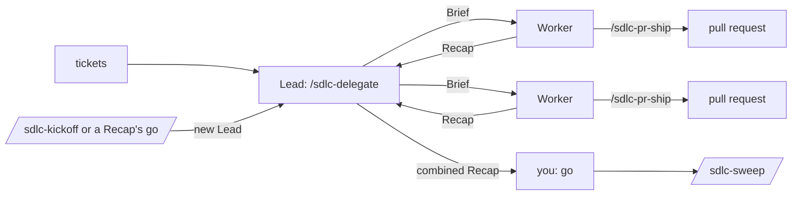

# sdlc-sessions

The session skills of [dw-sdlc](../../README.md), beside the [`sdlc`](../sdlc/README.md) plugin that
guards a session. They tell you where a session stands, kick off new work in a session of its own, and
let one session hand tickets to others running in parallel:

- `/sdlc-recap` writes a Recap: where a session stands, in one fixed shape, and whether it can close.
- `/sdlc-kickoff` writes a Brief, the fixed-shape first message of a Worker, a Claude Code session that
  works on one ticket in a worktree of its own, and starts a new Lead to carry it to the end.
- `/sdlc-delegate` makes the session a Lead, a session that starts Workers in herdr terminals and gathers
  their Recaps. herdr is a terminal manager whose `hc` command starts and reads terminals.

A Brief starts its Worker with `/implement`, and a Lead reads the tickets `/to-tickets` cuts: both are
[Engineering skills](https://github.com/mattpocock/skills), which this plugin runs beside and does not
ship. The decision to ship it apart from `sdlc` is
[ADR 0014](../../docs/adr/0014-session-helpers-ship-as-sdlc-sessions-beside-sdlc.md).



## Install

The [root README](../../README.md#install) installs it. It lists `sdlc` under `dependencies`, so it brings
the guards too.

| skill            | needs                                                                    |
| ---------------- | ------------------------------------------------------------------------ |
| `/sdlc-recap`    | nothing; an authenticated `gh` for the pull request and the next session |
| `/sdlc-kickoff`  | nothing; herdr's `hc` to start the Lead                                  |
| `/sdlc-delegate` | herdr's `hc` on the agent's PATH, and a terminal herdr started           |

`/sdlc-doctor` reports the plugin on its `sessions` line, a drift between its copy of the `dw-sdlc`
package and the one `sdlc` runs included, and herdr on its `hc` line.

## What it carries

| part             | kind     | runs                                                                     | section                     |
| ---------------- | -------- | ------------------------------------------------------------------------ | --------------------------- |
| `/sdlc-recap`    | skill    | you type it, or a Brief tells a Worker to end with it                    | [The Recap](#the-recap)     |
| `/sdlc-kickoff`  | skill    | you type it                                                              | [The kickoff](#the-kickoff) |
| `/sdlc-delegate` | skill    | you type it or ask in your words; offered after tickets in a set-up repo | [The Lead](#the-lead)       |
| `brief.md`       | template | read by every skill that writes a Brief                                  | [The Brief](#the-brief)     |

## The Recap

`/sdlc-recap` works in any session. Its first line is a verdict in the words of the Ship script's
Actions: `done`, `act` (the agent's turn), `wait` or `park` (the dev's), and one sentence. Each section
after it appears only when it has content:

- what happened, as a table of outcomes with links;
- the decisions taken without the dev;
- numbered questions, each with a recommendation;
- what waits on whom;
- the close line, from `dw-sdlc recap`;
- the follow-ups, each `now`, `issue`, `worker` or `drop`.

```text
park — #420 merged; one follow-up waits on you.

| outcome                               | link |
| the docs read right for a new reader  | #420 |

Can close: yes — merged.
Follow-ups: 1. Sweep: 1 branch — now.
```

One "go" from the dev carries out every recommended follow-up, "go, but 2 issue" changes one, and nothing
runs before it. In the main checkout, when a Sweep would remove anything, the Recap lists a Sweep as a follow-up `now`,
counting the branches, worktrees and terminals. When the
session can close, the Recap ends with [the next session](#the-next-session).

The Recap is written in the conversation's language, links pull requests and issues instead of listing
files, and checks every "merged" or "green" live with `gh`. Its description limits the model to the dev
typing `/sdlc-recap` and a Brief's instruction, so "co dalej?" gets a plain answer.

## `dw-sdlc recap`

The facts a Recap rests on, read-only: the branch and head, uncommitted and unpushed work, a paused git
operation, the branch's pull request and its Action, a linked worktree, the live Workers in herdr, and
under `next` the candidates for the next session. `dw-sdlc recap --help` says what each one counts.

Exit 0 means the session can be closed, 1 that it cannot, and 2 that the command cannot run. Under
`close`, the `--json` document gives the `verdict`, the `line` a Recap quotes and every reason, each with
`blocks`.

| reason              | blocks | when                                                                                                            |
| ------------------- | ------ | --------------------------------------------------------------------------------------------------------------- |
| `paused`            | yes    | a rebase, `git am`, merge, cherry-pick, revert or bisect is paused, however clean the tree reads                |
| `uncommitted`       | yes    | a change git would commit or could track                                                                        |
| `unpushed`          | yes    | commits past the upstream                                                                                       |
| `no-upstream`       | yes    | commits on no remote, on a branch with no upstream or a detached HEAD                                           |
| `open-pull-request` | yes    | the pull request is open, whatever its Action                                                                   |
| `orphaned`          | yes    | commits of a closed pull request left the branch, as by a reset, and no remote branch holds them                |
| `no-pull-request`   | yes    | commits on top of the base, no pull request holds the head, and the branch is neither the default nor protected |
| `workers`           | yes    | a Worker this session started as a Lead is live, whatever its status                                            |
| `merged`            | no     | the pull request merged                                                                                         |
| `closed`            | no     | the pull request closed without merging; commits only it holds read as `no-upstream`                            |
| `worktree`          | no     | a linked worktree, left to remove                                                                               |
| `clean`             | no     | no reason blocks                                                                                                |

Why it answers as it does:

- **It leans to "no".** An open pull request blocks even when parked on the dev, and a live Worker blocks
  even when its turn ended: a wrong "no" costs less than a wrong "yes".
- **It never fetches.** A branch force-pushed or deleted since the last fetch can read as holding the
  head. Run `git fetch --prune` first to be exact. Treating every moved branch as stale would answer no
  each time the base moves on. A remote out of reach holds nothing, so it answers no.
- **A commit a pull request holds counts as pushed**, so a branch whose pull request merged and whose
  remote ref is gone still closes.
- **The pull request comes from `gh pr view`**, then from the head branch the upstream names. It counts
  only when its commits hold the local `HEAD`, so a parent branch's pull request is never this one's.
  The limit follows: a branch pushed under another name, with commits its pull request lacks, gets no
  pull request, and those commits read as `unpushed` and `no-pull-request`.
- **A detached HEAD or no remote asks `gh` nothing**: the `pull request` line reads `gh not asked`. A
  remote on another host exits 2, and so does a failed `hc` in herdr.

## The next session

`dw-sdlc recap` lists the candidates: open issues labelled `ready-for-agent`, with no assignee and no open
blocker. The skill picks one, since only the session knows the topic it worked on. A Recap a Brief asks for
leaves the section out: a Worker's Lead names what comes next.

Nothing starts before the dev's "go", and "go, but #<m>" starts another candidate. "go" runs the
follow-ups first, filing each `worker` follow-up as an issue with a Brief as its body, then starts one
Lead for the candidate and those issues, the candidate first:

```bash
dw-sdlc lead start --name lead-<n>-<slug> --prompt "/sdlc-delegate #<n> #<m> ..." [--wait <seconds>] [--json]
```

It starts the Lead in a new herdr terminal in the main checkout; `dw-sdlc lead start --help` gives what
it runs and when it refuses. A Lead's terminal is no Worker's, so the closing session's `recap` and Sweep
leave it alone.

## The kickoff

`/sdlc-kickoff` takes an issue, a spec, a Recap's follow-up or an idea from the conversation, writes its
Brief and, on the dev's word, kicks the work off in a session of its own. Only the dev invokes it. The
session that kicks work off does not care for it: a new Lead does, so the session can close. Work this
conversation holds, carried on as it is, goes with `/handoff` of the Engineering skills instead.

| word    | what you get                                                                                              | when                                   |
| ------- | --------------------------------------------------------------------------------------------------------- | -------------------------------------- |
| `start` | a new Lead in herdr, `/sdlc-delegate` with the work, which starts the Worker and stays with it to the end | the work starts now                    |
| `issue` | a new issue with the Brief as its body, started later with `/implement #N`                                | the work waits                         |
| `line`  | `worker.command` with `--worktree`, `--model`, `--effort` and the Brief, to paste into a new terminal     | outside herdr, or in a linked worktree |

An idea or a follow-up with nothing filed is filed as an issue before the Lead starts, so the Lead reads it
as one.

## The Brief

`templates/brief.md` holds what every Brief shares: its fields, its rules, the Worker's name
(`worker-<issue>-<slug>`), the routing of model and effort, the start line, and how a session starts the
new Lead that carries the work. A Brief is in English and
points at its source without retelling it. Its kind sets the model and effort, never the size of the
change, and the dev's word wins over both.

A Worker carries its pull request through [`/sdlc-pr-ship`](../sdlc/README.md#shipping-a-pull-request),
which it may start because its Brief tells it to; `pr.merge` decides whether it ends merged or parked for
the dev.

## The Lead

`/sdlc-delegate` makes the session a Lead, and is how a session starts a Worker. The dev types it or asks
in their own words; after tickets are published in a repository with `.ai/agentic.config.json`, the
model offers it in one line and waits. It refuses outside herdr, in a Worker (a terminal labelled
`role=worker`) and in a linked worktree.

- **Tickets.** An issue or its open sub-issues, a list of issues, a spec in a file, or a split of the work
  when each piece is its own pull request. Closed tickets and those a triage label keeps for a human are
  skipped. `blockedBy` orders the rest; tickets with no edge between them run in parallel.
- **The plan.** The dev sees it as a table, and the Workers start without a second ask: the first alone,
  the rest once its Brief is delivered. At most three are in flight.
- **Waiting.** The Lead ends its turn while Workers work, so the dev can talk to it. A Worker's report
  wakes it.
- **The end.** Once every Worker has reported and the queue is empty, it gives one combined Recap. The combined
  Recap carries the Sweep follow-up, which removes the Workers' terminals and worktrees on the dev's "go".

While it has live Workers, the Lead:

- opens no question dialog, which would make `hc send` refuse its Workers' reports, and asks in plain text;
- writes no code and never merges: each Worker carries its own pull request through `/sdlc-pr-ship`;
- answers no Worker's question outside the Brief, and relays a parked question to the dev;
- takes the dev's answer given in a Worker's own terminal from that Worker's next Recap;
- removes no Worker's terminal or worktree itself: the Sweep does, on the dev's "go".

How it wakes, waits and counts its Workers is in `skills/sdlc-delegate/SKILL.md`.

## Config keys it reads

| key                             | read by                                                               |
| ------------------------------- | --------------------------------------------------------------------- |
| `worker.command`                | a Brief's start line, `dw-sdlc worker start` and `dw-sdlc lead start` |
| `worker.model`, `worker.effort` | the model and effort a Brief routes a clear spec to                   |
| `guardrails.protectedBranches`  | `dw-sdlc recap`, for a branch that needs no pull request of its own   |
| `pr.merge`                      | whether a Worker's pull request ends merged or parked for the dev     |

Each skill's evals, outside `pnpm test` and the Gate, are in [Evals](../../docs/contributing/evals.md).
