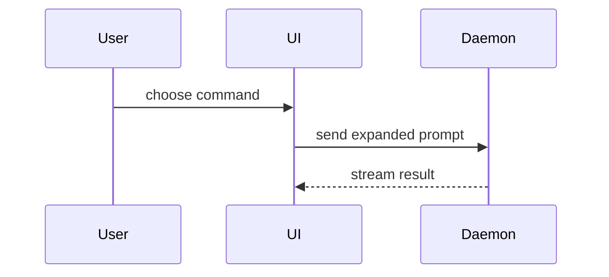

# Summary views

Pick the smallest view that makes the key point. One is usual, two is rare, all of them is wrong.
Place each next to the short text it supports and keep only the calls, files, states and boundaries
the reader needs. The views are adapted from the `show-me` skill by Dex Horthy, Humanlayer
(https://github.com/humanlayer/skills/blob/main/plugins/show-me/skills/show-me/SKILL.md).

## Logic or an algorithm: pseudocode

```text
on(save)
  if content is unchanged
    return cached result
  write new content
  return fresh result
```

## Runtime control flow: a call tree

```text
submitForm
  createSession
    persistPrompt
    launchAgent
  navigateToSession
```

## UI structure: a component tree

State and module boundaries that matter go in it.

```text
<SessionPage> (apps/example/src/routes/session.tsx)
  useSessionEvents()
  <SessionToolbar>
    <RunSkillButton> (packages/ui)
```

## File responsibility or a broad refactor: a shallow file tree

```text
src/
├── commands/       # parses user actions
├── sessions/       # owns session state
└── transport/      # sends API requests
```

## Component interaction or data flow: mermaid

Only when the change moves a flow or a sequence.



## What changes, where the shape already exists: a diff

Match the diff to the topic, a component tree, a file tree, a call tree or control flow.

```diff
 submitForm
   createSession
     persistPrompt
+    expandSkillMention
     launchAgent
-  navigateToSession
+  navigateToSession
+    subscribeToEvents
```

```diff
 on(save)
-  write content
+  if content is unchanged
+    return cached result
+  write new content
+  invalidate cache
```

## A copyable target shape: the whole block

When most of it is new, when omitted context hides ownership or order, or when the reader needs the
shape to copy.

```ts
function expandSkill(command: string): string {
  const skillName = command.slice(1)
  return `use the ${skillName} skill`
}
```
